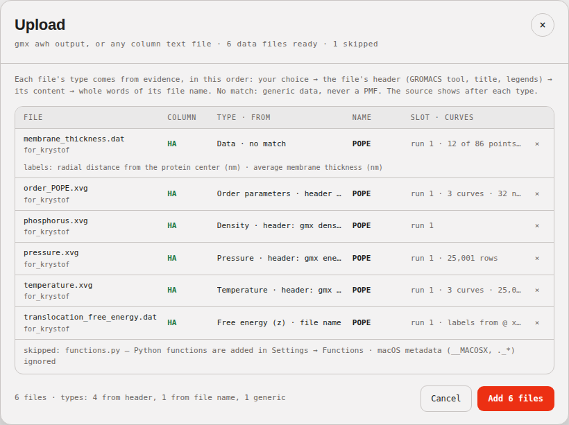
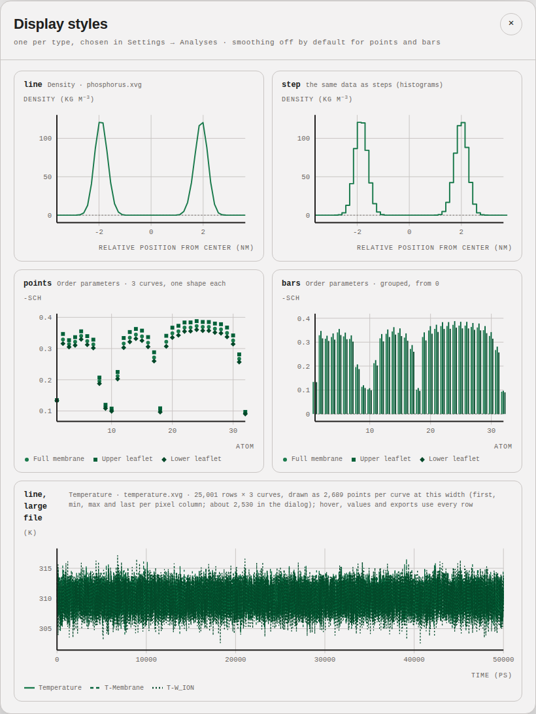
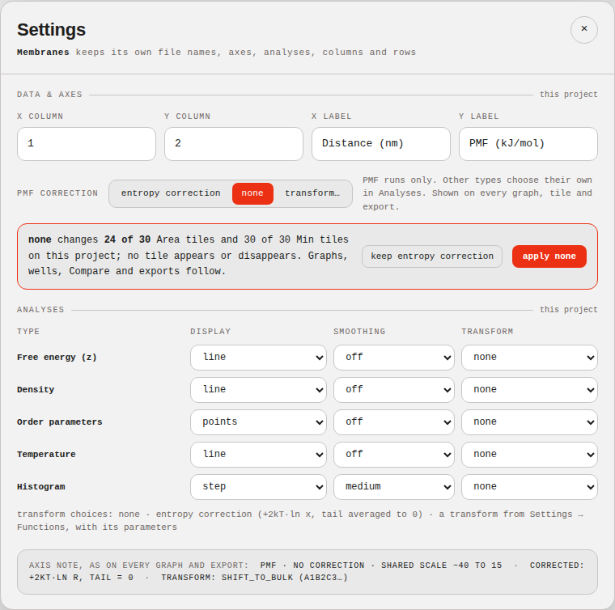
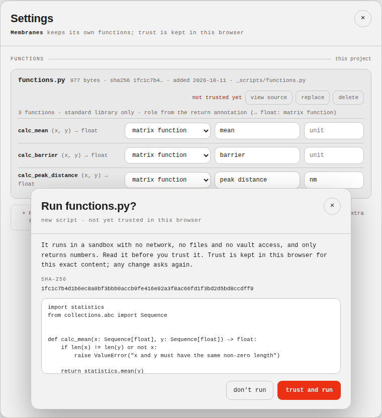
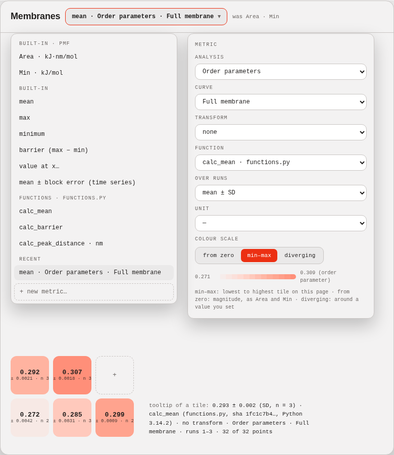
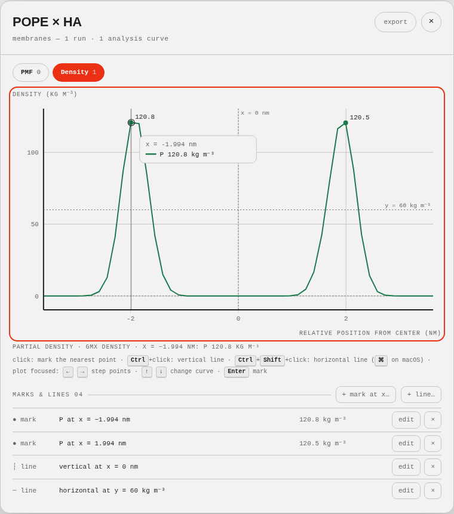
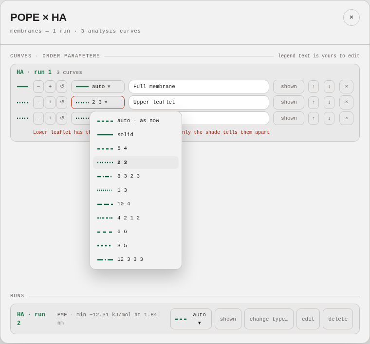
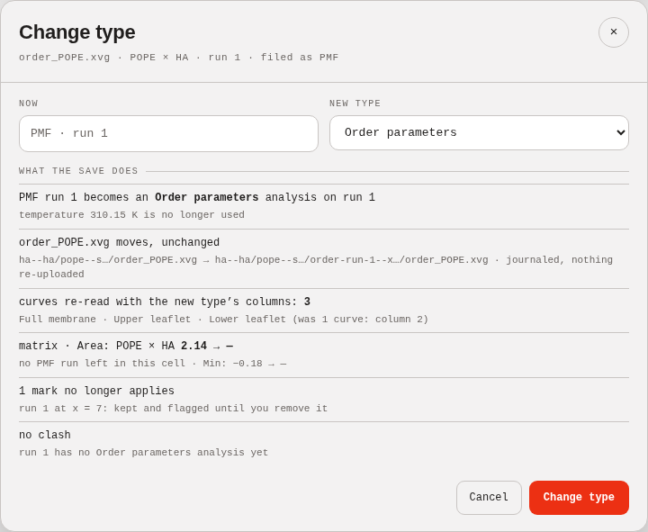
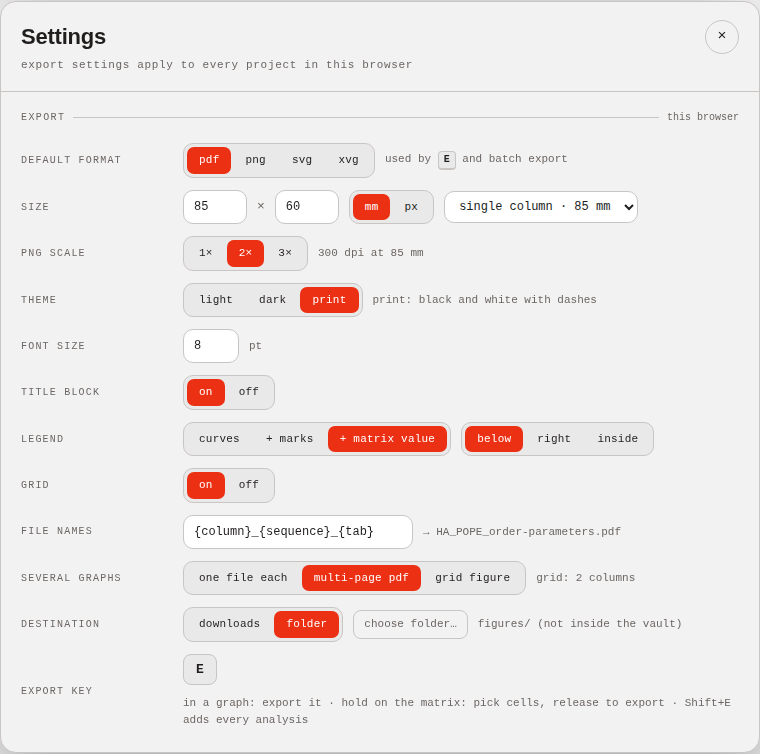
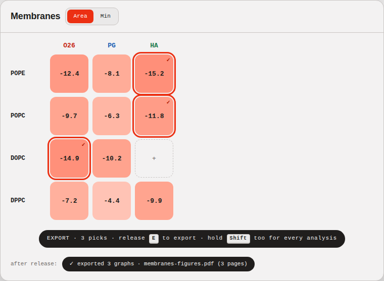

# Feature batch 3 — Phase 0 report

Phase 0 is done: baseline, the spec checked against the code, experiments for the riskiest parts, one on-disk plan, ten mock-ups and the open questions. No app code changed. **Section 10 holds every question in one numbered list; Phase 1 starts after your answers.**

Spec: `docs/feature-batch-3.md`. Mock-ups: `docs/img/batch-3/phase0-*.png`.

## 1. Baseline

- **Branch:** `feature-batch-3`, from `387ad7c` ("Final report for feature batch 2"), the tip of `feature-batch-2`. The repository has no remote, and Cypher's folder isn't in this checkout.
- **Lint:** `npm run lint`: 0 errors, 7 warnings (`react(only-export-components)` in `Laser.tsx` and `ui.tsx`).
- **Build:** `npm run build` passes, with 1 warning (direct `eval` at `node_modules/3dmol/build/3Dmol.js:43198`, in `makeFunction`).
- **Tests:** `npm test`: 390 tests pass in 20 files.
- **Formats:** vault schema 3; dataset export v6.

All numbers match section 0.1.

## 2. The spec against the code

I re-ran every claim marked "verified". Each one holds at the baseline:

| Claim | How I checked it | Result |
|---|---|---|
| `translocation_free_energy.dat` is filed as Energy, with its labels lost | `parseTable` and `detectAna` on the file | confirmed: `{k:'energy', from:'auto'}`; head empty |
| `membrane_thickness.dat` falls back to PMF, and the `nan` rows are dropped | as above, plus `runFromTable` | confirmed: PMF; 74 of 86 points kept |
| `order_POPE.xvg` falls back to PMF, using only the first column | as above | confirmed: 4 columns parsed; a PMF run uses column 2 |
| `phosphorus.xvg`, `temperature.xvg` and `pressure.xvg` are unknown | `parseGmxHeader` and `detectAna` | confirmed: the tools are `gmx density` / `gmx energy`; "GROMACS Energies" doesn't contain "energy" |
| The reference values in section 3 | `functions.py` in CPython 3.11.15 and in Pyodide 314.0.7 (Python 3.14.2) | all confirmed; both give identical results |
| The correction distorts the translocation profile | `correctCurve` on the file | confirmed: at x = −7.017, −1.159 → −10.96; min −36.80 → −46.07; max 84.577 → 75.00 |
| The matrix always uses the corrected curve | code (`seq.ts:480–503`) | confirmed |
| Axis labels come from the type | code (`DetailDialog.tsx:253`) | confirmed |
| `cleanLabel` strips Grace markup | code (`seq.ts:401`) | confirmed |
| Folder import offers 12 files | `filesFromInput` on the unzipped archive | confirmed: the 6 data files and 6 `__MACOSX/for_krystof/._*` files |
| Pyodide in Node | `functions.py` run in Pyodide | load 2.37 s; signatures listed; `calc_peak_distance` on phosphorus = 3.98748; the `ValueError` arrives with its message; `js.fetch` reachable |
| Sandbox facts in section 1.4 | headless Chromium (section 5) | all confirmed |

**Where the spec and the code or files differ:**

1. **Morpheus brand book.** `project/README.md` isn't in this repository. Morpheus's brand book is `project/README.md` inside the Morpheus artifact. I read it there, with its LineChart, HeatCell, Kbd, Toaster, ToggleGroup, Select, Dialog and Tooltip guidelines. The repository's `project/_ds/` holds the original "Modernist" system.
2. **Primary colour.** Morpheus describes a pastel coral primary, but the app uses its red accent (`--acc` `#ec3013`). I follow the app (section 1.1: don't restyle). The mock-ups use the app's own stylesheet.
3. **`sameKey`.** It isn't a configurable key: it's the key-matching helper in `Laser.tsx:31`. The configurable keys are `laserKey` and `compareKey`.
4. **The correction's tail.** `correctCurve` doesn't set the last 10 % of points to zero. It subtracts their mean, so the tail averages zero (`pmf.ts:66`).
5. **More network APIs than listed.** A module worker exposes more than section 1.4 lists: also `WebSocketStream`, `WebTransport`, `FontFace` and `self.fonts` (a font load is a request). The deny-list should include them.
6. **Workers in an opaque origin.**
   - In a sandboxed (opaque-origin) iframe, a module worker created from a `blob:` URL doesn't start, but a `data:` URL worker does.
   - A `data:` URL worker gets an opaque origin even when a normal page creates it.
7. **Arrow keys already taken.** The detail dialog already uses the arrow keys to walk rows and columns (`App.tsx:331–333`). R5's keyboard stepping has to take precedence while the plot has focus.
8. **`order_POPE.xvg` header.** It has no GROMACS header (another tool wrote it). Its labels are `Atom` and `-Sch`.
9. **Values not in section 3:**
   - `calc_peak_distance` on the translocation profile: 1.84 nm;
   - `calc_barrier` on the 74 finite thickness points: 0.45883 nm;
   - the block-averaged errors of the energy means: section 6, R4.
10. **Uppercased units.** The app uppercases axis titles in CSS, so units read "KG M⁻³" and "NM". "mV" would read "MV" (megavolts). See question 29.

## 3. The example files

The archive holds the 7 files of section 3, plus `__MACOSX/` with 7 `._*` metadata files. Three GROMACS files (`phosphorus.xvg`, `pressure.xvg`, `temperature.xvg`) carry `Working dir: /mnt/storage-…/nfs4/home/<user>/all-atom/membranes/POPC/3_md`, which names your colleague's cluster home folder and user name (question 1). I haven't committed anything from the archive.

| File | Header and content | Today (verified) | Proposed: type · from | Display | Tile (reference, recomputed) |
|---|---|---|---|---|---|
| `translocation_free_energy.dat` | `@ xlabel` / `@ ylabel`, 365 rows, x −7.479…7.379 nm, trailing spaces | Energy · file name; labels lost | **Free energy (z)** · file name ("free energy", "translocation") | line, **no correction**, labels "distance from the transmembrane state (nm)" / "free energy difference (kJ mol⁻¹)" | `calc_barrier` 121.377 kJ/mol |
| `membrane_thickness.dat` | `@ xlabel`/`@ ylabel`, 86 rows, 12 `nan` | PMF (fallback); 12 rows dropped | **Data** · no match | line with gaps | `calc_mean`: nan as written; 3.83832 nm over the 74 finite points (question 6) |
| `order_POPE.xvg` | title "Atomistic order parameters for molecule type POPE", 32 rows × 3 legends, `# Atom C22:` before each row | PMF (fallback); 1 column | **Order parameters** · header title | **points**, smoothing off | `calc_mean` 0.292503 / 0.306884 / 0.281922; `calc_peak_distance` raises "x must contain values on both sides of 0" |
| `phosphorus.xvg` | `gmx density`, 50 rows, `Density (kg m\S-3\N)` | unknown | **Density** · header (gmx density) | line, "Density (kg m⁻³)" | `calc_peak_distance` 3.98748 nm (peaks at ±1.99374) |
| `temperature.xvg` | `gmx energy`, 25,001 rows × 3 terms, y label "(K)" | unknown | **Temperature** · header (gmx energy + legend) | line, decimated for drawing | mean 310.0434 / 310.2416 / 309.7747 K; SD 1.357 / 1.520 / 1.811 K; block error ±0.012 / ±0.012 / ±0.013 K |
| `pressure.xvg` | `gmx energy`, 25,001 rows, "(bar)" | unknown | **Pressure** · header (gmx energy + legend) | line, decimated | mean 2.2994 bar, SD 168.953 bar, block error ±1.16 bar |
| `functions.py` | `calc_mean`, `calc_barrier`, `calc_peak_distance`; `-> float`; no docstrings | skipped (not data) | Settings → Functions | — | — |

**Numeric precision.** Analysis curves are stored to 6 significant digits (D15, `curveFromTable`). Section 3's reference values survive that rounding at the digits they're given (checked for all of them). Scripts get the curve as the app stores it, so a script's result never depends on whether a cache exists.

## 4. Performance today, and a target

Measured on the production build (`vite preview`) in headless Chromium, with `temperature.xvg` (25,001 rows × 3 curves). Long tasks are the main-thread tasks over 50 ms, as Chrome's Performance panel shows them (`PerformanceObserver('longtask')`). The open and redraw steps include 1.5 s to settle, so their paint is counted. Two runs:

| Step | Longest task | Notes |
|---|---|---|
| Pick file → plan shown | 0–55 ms | parse in Node: 40 ms |
| Add → saved | 99–102 ms | |
| **Open the cell → graph drawn** | **1,003–1,028 ms** | three SVG paths of ≈ 298 kB each |
| Pointer moves over the plot | 0–166 ms | no handlers today; leftover paint |
| **Export png** | **3,999–4,271 ms** | rasterising the full-resolution scene |
| Export pdf | 222–236 ms | |
| Export xvg | 82–84 ms | |
| Toggle a run (redraw) | 165–753 ms | |

`pressure.xvg` (1 curve) is lighter: open 134 ms, png 1,188 ms.

**Proposed target (question 30):** on the production build with `temperature.xvg`:
- **Interactions:** no main-thread task over **100 ms** when opening a graph, hovering, stepping with the keyboard, or toggling or restyling curves.
- **Exports:** no task over **200 ms** for one export.
- **Batch exports** yield between graphs.

Scripts run in a worker, so they never count against the target. Drawing decimated to the pixel columns (R1c) gives about 2,530 points per curve instead of 25,001 at the dialog's plot width (648 px; mock-up 2), and keeps every local maximum and minimum.

## 5. Running uploaded Python safely: experiments and recommendation

I built a two-origin test harness: the app origin (`127.0.0.1:5301`) serves the pages and the Pyodide files, and a second origin (`localhost:5302`) logs every request that reaches it. The worker loads Pyodide 314.0.7 and then strips the deny-list (layer 1). After that, Python probes everything it can reach, and the worker's own JavaScript also tries to bypass layer 1 on purpose, to test layer 2 alone.

| Variant | Python load | Deny-list names reachable | `js.eval` | Vault DB `pmf-vault-handles` | Lock `pmf-vault:…` | `import()` / `fetch` to the other origin |
|---|---|---|---|---|---|---|
| Worker from its own URL, page with a meta CSP | 2.5 s | none | **runs** | blocked (layer 1) | blocked (layer 1) | **reached** (both logged) |
| Blob worker, page meta CSP, **no** deny-list | 2.4 s | all | refused | **opened** | **requested** | blocked |
| Blob worker, page meta CSP + deny-list | 2.5 s | none (prototype chain empty) | refused | blocked | blocked | blocked |
| **Page without CSP** + same-origin helper frame with the strict CSP + blob worker + deny-list | 2.4 s | none | refused | blocked | blocked | blocked |
| Sandboxed (opaque) iframe, blob module worker | — | — | — | — | — | worker doesn't start |
| **Helper frame + opaque `data:` worker**, Pyodide handed over as bytes (no deny-list yet) | 2.4 s | — | refused | **`SecurityError`** | **`SecurityError`** | blocked, the app's own origin too |

The strict CSP was `default-src 'none'; script-src 'self' 'wasm-unsafe-eval'; connect-src 'self'; worker-src blob:` for the blob workers, and `default-src 'none'; script-src 'self' blob: 'wasm-unsafe-eval'; connect-src 'self' blob:; worker-src data:` for the `data:` worker. Also measured:
- **Timeout:** an endless `while True: pass` is stopped by terminating the worker after 2,001 ms. During Pyodide's load and the loop the page's timer kept its full rate, with no long task on the main thread.
- **The app with a page-wide CSP:** in the production build (`vite preview`) everything works with zero violations: the 3D viewer, png export, the Crossref request and the sandbox. On the dev server the app doesn't start, because Vite's inline React-refresh preamble is refused (and its HMR websocket would need `ws:`). The dev server serves files in `public/` untouched, so a helper page there keeps its CSP in dev and build alike.
- **3Dmol's `eval`:** it only runs for callbacks given as strings (a py3Dmol feature the app never uses). It never runs in the app.

**Recommendation (question 13).** Run Python in a hidden same-origin helper page, `public/py/sandbox.html`, which:
1. carries the strict CSP itself (layer 2), so the app page needs no CSP and Crossref, the fonts, 3Dmol and the Vite dev server are untouched;
2. fetches Pyodide's five files from the app (same origin, no CORS needed);
3. starts an **opaque-origin `data:` module worker**, which inherits the helper page's CSP, and hands it the files as bytes;
4. in that worker, loads Pyodide and then removes the deny-list along the prototype chain (layer 1, including the four extra names in section 2);
5. relays calls and terminates the worker when a call runs over its time limit.

Both of section 1.4's layers are kept. The opaque origin adds a third guarantee: IndexedDB, Cache Storage and Web Locks throw `SecurityError` even if a future browser API slips past the deny-list.

- **Pyodide 314.0.7:** published 2026-09-14, Python 3.14.2.
- **Download, once, on first script use:** `pyodide.mjs` 18 kB, `pyodide.asm.mjs` 1.25 MB, `pyodide.asm.wasm` 9.6 MB, `python_stdlib.zip` 2.5 MB and `pyodide-lock.json` 119 kB. That's 13.5 MB raw, 6.3 MB if the host gzips (the stdlib zip barely compresses).
- **numpy:** couldn't be measured here. This environment's network policy blocks the Pyodide CDN, and PyPI has no WebAssembly numpy wheel (question 11).

## 6. The requests

Budgets are app code only (lines added / removed); tests are counted separately.

### R1 — Any data in, shown properly

**Current behaviour (verified):**
- **`parseTable`** (`seq.ts:404`):
  - it skips `#` and `&` lines and reads `@ title`, `@ xaxis label`, `@ yaxis label` and `@ sN legend`, quoted values only, through `cleanLabel` (`seq.ts:401`), which drops Grace codes;
  - `@ xlabel` / `@ ylabel` are ignored;
  - rows are split on whitespace only, so a comma-separated row is skipped;
  - `nan` becomes NaN.
- **Missing values:** analysis curves keep NaN as a gap (`curveFromTable`, `seq.ts:441`); PMF runs drop the row (`pickXY`, `seq.ts:427`).
- **`detectAna`** (`seq.ts:375`, F35/F41):
  - the tool `gmx awh` or the title "AWH" → PMF;
  - keywords in the title and y label (substrings for ≥ 4 letters) → header;
  - keywords in the file name → `auto`;
  - otherwise PMF, or unknown for another GROMACS tool (F32).
- **Display:** `AnalysisType.style` is `line | step` (`types.ts:139`); labels come from the type (`DetailDialog.tsx:253`).
- **OS clutter:** `isOsClutter` (`path.ts:100`) knows `.DS_Store`, `Thumbs.db`, `desktop.ini` and `.git`.
- **Drawing:** `buildPlotMulti` (`seq.ts:1284`) draws every point.
- **Existing fixtures:** all are recognised by their GROMACS header (none falls back to PMF). The one that changes under the proposal is `07.md_numcont_protein_sugar.xvg` (a `gmx mindist` file that matches no type): unknown → Data.

**R1a — parser (proposed).**
- `parseTable` also reads `@ xlabel` / `@ ylabel` (quoted or not), accepts commas between values, keeps `nan`, and records a comment line directly above a data row (`# Atom C22:`) as that row's name, in `head.rowLabels`.
- A pure `labelParts(text)` turns Grace `\S…\N`, `\s…\N` and `\x…\f{}`, and LaTeX `$^{…}$`, `$_{…}$` and `$^x$`, into text with super- and subscripts. Unknown codes are dropped as today; nothing is added.
- `unitOf(label)` returns the last `(…)` or `[…]`.
- **Rendering:**
  - on screen, `` and `` in the axis labels;
  - in SVG and PNG, `tspan` with a baseline shift;
  - in PDF, a text rise (Helvetica's WinAnsi has no "⁻", and `pdfStr` turns it into "?", `export.ts:246`).
- `isOsClutter` adds `__MACOSX` and names starting with `._`.
- The parser version moves, so the parsed-table cache rebuilds. Stored numbers don't change.
- **Golden test first:** every existing fixture parses exactly as before (frozen in F-0).

**R1b — recognition (proposed).**
- **Evidence, in order:**
  1. your choice;
  2. the header: the GROMACS tool, then whole words and phrases in the title, y label and legends;
  3. content rules a type declares;
  4. whole words of the file name;
  5. generic **Data**.
- **Scoring:** the type with the most matched words wins, a tool match outranks words, and ties go by list order. This fixes the file-name rule: "translocation_free_energy" matches "free energy" (2 words) ahead of Energy's "energy" (1 word).
- **Built-in types:** Free energy (z), Density, Order parameters, Temperature, Pressure, Energy (other `gmx energy` terms) and Data (question 4).
- The source is stored with the type assignment (`typeFrom`, section 7), so graphs and run cards can say "Order parameters · from header title".
- "distance" is never evidence of a radial coordinate: the x label isn't used as evidence.
- An unknown file becomes Data, never PMF (question 3).

**R1c — display (proposed).** This item starts with **G-0 (new, section 9): the graph model out of `DetailDialog`**. A pure `buildGraph()` in `src/lib/graph.ts` returns what the dialog draws today (series, markers, labels, notes, legend). DetailDialog renders it and exports reuse it, with golden scenes equal. Then:
- **Styles:**
  - `line` and `step`;
  - `points`, one shape per curve (circle, square, diamond, triangle…), so colour is never the only difference;
  - `bars`, grouped, from 0 or from the axis bottom when 0 is outside.
- **Smoothing** is off by default for points and bars.
- **Labels:** the precedence in question 2.
- **Decimation:** a pure `decimate()` keeps the first, minimum, maximum and last point of each pixel column. `buildPlotMulti` uses it for drawing only. Values, markers, hover and `xvg` exports use the full data.

| | |
|---|---|
| **Files** | `seq.ts`, `types.ts`, new `graph.ts`, `DetailDialog.tsx`, `Plot.tsx`, `export.ts`, `SettingsDialog.tsx` (Analyses: display, tools), `UploadDialog.tsx` (type · source), `storage/path.ts`, `storage/cache.ts` (parser version) |
| **Budget** | R1a +110 / −10 · R1b +90 / −25 · G-0 +170 / −150 (moved) · R1c +140 / −20 |
| **On disk** | parsed-table cache rebuilds (derived); `typeFrom` on records and new keys in `analyses.json` (section 7) |
| **Tests** | `parser.test.ts`: every example file, `@ xlabel` forms, `nan`, commas, Grace/LaTeX labels, row names, every existing fixture unchanged · `folderImport`: the unzipped archive, `__MACOSX` included, offers the 6 data files · labels: the agreed precedence on every example file · `recognition`: examples and fixtures → type and source · `decimate`: keeps every local extreme; nothing computed uses it · G-0: golden graph models and scenes |
| **Risks** | Bare two-column files now arrive as Data, not PMF (intended). File labels change existing analysis graphs, so golden export tests change with a recorded decision. Whole-word matching drops partial-word hits. |
| **Questions** | 2, 3, 4, 5, 6 |

### R2 — The PMF correction as a setting

**Current behaviour:**
- The correction is fixed (`CORRECTION`, `pmf.ts:64`), and `curveStats` always applies it (`seq.ts:480`).
- The corrected/raw switch is session state in `App.tsx:81`, used only by the graphs (DetailDialog, Compare).
- The "Well at" tile says "corrected curve".

**Proposed:**
- **The setting:** a transform per type (question 7): `none | entropy | script (+ parameters)`.
  - PMF's lives in `settings.json` (`pmfTransform`, default entropy);
  - other types' live in `analyses.json` (`transform`, default none; Free energy (z): none).
- **One pure function:** `applyTransform(ref, x, y, {temp})` reuses `correctCurve` unchanged.
- **Everything follows:** `curveStats(run, ref)` caches per transform, so `cellValue`, wells, markers, Compare and exports all follow the setting.
- **Where you set it:** Settings → Data & axes has "PMF correction" (`entropy correction · none · transform…`); Settings → Analyses has one select per type (mock-up 3).
- **Before applying:** `tileDiff(before, after)` counts the tiles that change, appear or disappear, and a confirm strip shows the counts.
- **Named everywhere:** the graph's axis note, the tile tooltip, and the export kicker and note ("corrected: +2kT·ln r, tail = 0" / "no correction" / "transform: name (sha…)").
- **The dialog switch:** question 8.

| | |
|---|---|
| **Files** | `seq.ts`, `pmf.ts` (no maths change), `types.ts`, `App.tsx`, `graph.ts`, `CompareDialog.tsx`, `SettingsDialog.tsx`, `export.ts` |
| **Budget** | +100 / −35 |
| **On disk** | `settings.json` `pmfTransform`; `analyses.json` `transform` (section 7) |
| **Tests** | each choice through `cellValue`, wells and exports · golden Area, Min and wells with the default (identical, bit for bit) · the translocation profile unchanged with "none" · `tileDiff` counts |
| **Risks** | A script transform is asynchronous: graphs and tiles show "computing…" until it returns (R3c). |

### R3 — Custom Python scripts

**R3a — worker (proposed, needs your yes, question 12).**
- **The dependency:** `pyodide` 314.0.7.
- **Serving the files:** a small plugin in `vite.config.ts` copies Pyodide's five runtime files to `/pyodide/` in dev and build. Nothing is committed.
- **The helper page:** `public/py/sandbox.html` + `sandbox.js` implement section 5's design.
- **App side:** `src/lib/py.ts` creates the hidden frame on the first script call and gives each call a promise.
- **Time limit:** each call has one (question 14). Past it, the worker is terminated and restarted on the next call (about 2.4 s).

**R3b — script files (proposed).**
- **Storage:**
  - a `.py` file is stored byte for byte in `{project}/_scripts/` (reserved, like `_imports`), as a `FileMeta` of kind `script` listed in `ProjectRecord.scripts`, with your per-function settings;
  - the folder scan counts these files as tracked;
  - replacing or deleting a script moves the old version to the trash.
- **Discovery:** it runs in the worker with `inspect`: names, parameters (kind, default, annotation), return annotation and docstring. It's cached per SHA-256.
- **Trust:** kept in IndexedDB in this browser, per (vault folder, script record, SHA-256) (question 16). A changed byte, a copied vault (a different folder, `isSameEntry`) or an import (a new script record) asks again. The prompt shows the source and the full SHA-256 (mock-up 4).

**R3c — calls (proposed).**
- **One interface** for both roles: `callScript(…) → value | y | (x, y) | error`.
- **Missing values:** dropped before the call, and the count is shown (question 6).
- **Validation:** type, length and finiteness are checked. A transform must return y of the same length, or an (x, y) pair.
- **Errors** are shown with Python's message.
- **Caching:** results are cached in `.matrix/cache/<pid>/values.json`, keyed by data SHA-256, script SHA-256, function, parameters, transform and Python version.
- **Provenance:** every result carries a short provenance text.
- **The contract** (question 9):
  - the role comes from the return annotation;
  - extra parameters after `x, y` may be `float`, `int`, `bool`, `str` or `Literal[…]`, with defaults (question 10);
  - their values are stored where the function is used;
  - a docstring line `unit: nm` declares the unit.
- **Modules:** the standard library (question 11).

| | |
|---|---|
| **Files** | `package.json`, `vite.config.ts`, `public/py/sandbox.html`, `public/py/sandbox.js`, new `src/lib/py.ts`, `src/lib/scripts.ts` (pure: contract, validation, parameters, missing values, provenance), `src/lib/trust.ts`, `storage/records.ts`, `plan.ts`, `model.ts`, `project.ts`, `path.ts`, `exchange.ts`, `SettingsDialog.tsx` (Functions section, trust prompt) |
| **Budget** | R3a +200 · R3b +210 / −5 · R3c +140 |
| **On disk** | `_scripts/`, `ProjectRecord.scripts`, file kind `script`; the values cache; trust stays in the browser |
| **Tests** | Node, real Pyodide: discovery on `functions.py`; calls match CPython on every example file, errors included; parameters (defaults, annotations, bad values refused); validation; the missing-value rule; a changed input recomputes · vault: byte-identical after reopen; trash on replace; export v7 round trip; an import asks for trust · browser (question 15): every deny-list name unavailable, including through `js.eval` and the prototype chain; `pmf-vault-handles` and `pmf-vault:<id>` unreachable; `import()` to another origin refused; an endless loop stopped; the page stays responsive |
| **Risks** | 6.3–13.5 MB on first use, and 2.4 s to start ("starting Python…"); tens of MB of memory in the worker; a restart after a timeout; Python 3.14 semantics. |

### R4 — The matrix from any analysis and any function

**Current behaviour:**
- The metric is `'area' | 'min'`, session state in `App.tsx:80`; tiles come from `cellValue` (`Matrix.tsx:68`).
- Colour is `(|v|/max)^0.55` (`pmf.ts:51`) on the heat ramp (`pmf.ts:19`).
- The legend is in `App.tsx:636`; the matrix export (`export.ts:146`) says "AREA MAGNITUDE".
- Rows are ranked by the mean of their cell values (`App.tsx:282`).

**R4a — metric definitions (proposed).**
- **A metric** is a `MetricDef` (section 7): type, curve (by legend or column), transform, function (built-in or script) with parameters, aggregation (mean, n, SD), unit, colour scale, and optionally "on smoothed data" (then provenance says so).
- **Built-ins** (question 18):
  - area and min (PMF, today's numbers);
  - mean, max, minimum, barrier (max − min);
  - value at x (linear interpolation; an error outside the data);
  - mean ± block error (Flyvbjerg–Petersen; the largest standard error over levels with at least 32 blocks).
- **Block errors on the examples:** temperature 310.043 ± 0.012 K; pressure 2.30 ± 1.16 bar (SD 169 bar). These series are only weakly correlated, so blocking barely changes the error, but the tile can say it accounts for correlation.
- **`cellValue`** returns value, n, SD, error or provenance; scripts' results come through the values cache.
- **The picker** replaces the Area/Min toggle: built-ins, script functions, recent metrics, "+ new metric…" (mock-up 5).

**R4b — scales and tiles (proposed).**
- **Tiles:** value and unit, "± SD" when n > 1, "—" with a reason, "…" while computing; the tooltip carries the full provenance (question 19).
- **Colour scales:**
  - **from zero:** today's;
  - **min–max:** the lowest value maps to the first *tinted* step. Mock-up 5 showed why: on the ramp's first stop a tile looks empty, because that stop is the page colour.
  - **diverging around a value:** the coral ramp above it, a sky ramp below.
  - **Edge cases:** all values equal, or a single value, take the middle step.
- **Legend and matrix export** show the scale and the unit.

**R4c** checks section 3's reference values in the example files' tiles.

| | |
|---|---|
| **Files** | `seq.ts`, new `src/lib/metrics.ts` (built-ins, block averaging, scales; pure), `App.tsx`, `Matrix.tsx`, `export.ts`, `types.ts`, `storage/settings.ts` (`metrics.json`), page records |
| **Budget** | R4a +200 / −45 · R4b +130 / −30 · R4c +20 |
| **On disk** | `metrics.json`; the current metric per page (question 17) |
| **Tests** | golden Area and Min · every built-in, table-driven (block error against a reference implementation) · aggregation with spread · scale mapping (from zero, min–max, diverging, all equal, single value) · tiles of the example files · a function error shown in its tile |
| **Risks** | Script metrics fill in asynchronously, so the rank order updates when they arrive; the cost of many cells × runs × scripts (cached); changes D38 if pages keep their metric. |

### R5 — Interactive graphs

**Current behaviour:**
- `Plot.tsx` has no handlers. The zero line is dashed `2 3`.
- Markers per type exist (batch 2).
- The arrow keys walk rows and columns in the dialog.
- The laser canvas ignores pointer events (`Laser.tsx:143`), so clicks reach the plot.

**R5a — hover readout (proposed).**
- **Nearest point:** a pure `nearestPoint()` searches the full data by binary search on sorted x.
- **On screen:** a crosshair, and a readout listing each visible curve's name, x, y and units (mock-up 6).
- **With smoothing on:** see question 21.
- **Keyboard:** the plot is focusable (`tabIndex 0`). ← and → step through points, and ↑ and ↓ change the curve. The dialog's row and column arrows stand down while the plot has focus (question 22). The readout is announced.

**R5b — marks (proposed).**
- **Adding one:** a click within 12 px of a visible curve marks the nearest data point. By keyboard, Enter marks the point at the cursor.
- **Look:** a 4 px dot in the curve's colour, labelled with its value (Morpheus).
- **Stored:** `{curve, x}`. It's flagged when the curve is gone or x has no data point.

**R5c — reference lines (proposed).**
- **Adding one:** Ctrl+click (⌘+click on macOS) adds a vertical line at x; Ctrl+Shift+click adds a horizontal one at y. Ctrl/⌘+Enter and Ctrl/⌘+Shift+Enter do the same from the keyboard.
- **Look:** styled like the zero line and labelled with its value.
- **Key labels** follow the platform.

**R5d — stored and shown (proposed).**
- **Storage:** section 7 (question 20).
- **The list** under the graph edits values by keyboard and removes by arm and confirm.
- **Drawn in** Compare (question 20) and in exports.
- **No marks or lines are added while the laser is on** (question 22).

| | |
|---|---|
| **Files** | `Plot.tsx`, `seq.ts` (snap, coordinates), `graph.ts`, `DetailDialog.tsx`, `CompareDialog.tsx`, `export.ts`, `types.ts`, `records.ts`, `plan.ts`, `model.ts` |
| **Budget** | R5a +130 / −5 · R5b +90 · R5c +60 · R5d +120 / −10 |
| **On disk** | row record `marks` and `lines` (section 7) |
| **Tests** | snapping: nearest point and nearest curve, gaps, hidden curves ignored · pixel ↔ data on linear axes · marks survive reopening and appear in exports · a mark is flagged after its curve is replaced |
| **Risks** | Touch screens have no hover (a tap then marks). The ⌘ key on macOS needs a manual check there. |

### R6 — Line style per curve and run

**Current behaviour:**
- Dashes come from position: `graphShades` gives `i`, and `DASH[i % 10]` follows (DetailDialog `look()`).
- Curve records store `vis` and `shade` (`records.ts:45`). Runs have no display fields.

**Proposed:**
- **Storage:** `dash` (0–9) on `CurveRec` and `RunRec`.
- **The control:** next to each curve and each run card, a button with the current swatch opens a keyboard-operable list (auto plus the 10 patterns, mock-up 7). `look()` uses the stored dash, otherwise today's rule.
- **Everywhere:** Compare and exports follow.
- **Duplicates:** two curves with the same dash in one graph get a warning (question 23).

| | |
|---|---|
| **Budget** | +60 / −5 |
| **On disk** | `dash` fields (section 7) |
| **Tests** | round trip through the vault and the export format · automatic equals today's dashes |

### R7 — Change an analysis's type

**Current behaviour:**
- `moveExtra` (`seq.ts:650`) only moves an analysis between slots.
- The planner moves a file when its owner's folder changes (`plan.ts:198–211`), but keeps the file's old `kind` (`plan.ts:211`).
- A removed run whose file is still used goes to the trash as a record only (`plan.ts:353`, its step 7).

**Proposed:**
- **One pure function:** `retype(store, rowId, target, toType, options, tables) → { store, preview }`. The dialog reads the original once and passes the parsed table in.
- **The preview** lists exactly what the save does (mock-up 8):
  - the record change;
  - the file move, old → new path;
  - the curves, re-read with the new type's columns (question 24);
  - matrix values for the current metric, before and after;
  - marks that no longer apply;
  - clashes, with replace or add as curves, and exactly what goes to the trash.
- **PMF run ↔ analysis** (question 24): → PMF asks for a temperature.
- **Planner fix:** the file's `kind` follows its new owner.

| | |
|---|---|
| **Budget** | +180 / −10 |
| **On disk** | `typeFrom: 'changed'` |
| **Tests** | re-typing within analyses · run → analysis and back · clashes · the preview equals what the save does · originals byte-identical · journaled · trash and restore |
| **Risks** | Restoring the old run's trash item would compete for the file the analysis now owns, so restore refuses with a message (tested). A missing original keeps the current curves, and says so. |

### R8 — Exports

**Current behaviour:**
- `ExportMenu` (`ui.tsx:66`) offers `xvg`, `png` and `pdf` (`ui.tsx:63`). `toSVG` exists (`export.ts:207`) but isn't offered.
- The graph is built inside the dialog. The matrix export lives in `App.tsx:453`.
- Exports go to downloads only. The compare key shows how a held key picks cells (`App.tsx:313`).

**R8a — Settings → Export (proposed).**
- **The section:** mock-up 9; browser preferences (question 25).
- **Destination folder:** its handle is kept in IndexedDB, refused inside the vault (`resolve()` against the vault handle), with downloads as the fallback.
- **Pure helpers:** `exportLayout()` (mm → px at a dpi, sizes, font) and `exportName()` (template, collisions `-2`, `-3`).

**R8b — the E key in the dialog (proposed).**
- E exports the graph exactly as shown (the same `buildGraph` model) in the default format, with a toast "✓ exported HA_POPE_order-parameters.pdf".
- `exportKey` is configurable like the compare and laser keys, and never fires while typing.

**R8c — hold E on the matrix (proposed).**
- Hold E and click cells, as with C. A pill reads "EXPORT · 3 picks · release E to export · hold Shift too for every analysis" (mock-up 10).
- Release exports each picked cell's graph with its stored settings (question 26). Shift+E adds every analysis.

**R8d — legend and several graphs (proposed).**
- **Legend:** curves, + marks, or + matrix value (value ± spread, unit, function, transform).
- **Several graphs:** a multi-page PDF (`toPDF` gains pages), a grid figure (scenes placed in one scene), or one file each (question 27).

| | |
|---|---|
| **Files** | `ui.tsx`, `export.ts`, `graph.ts`, `App.tsx`, `DetailDialog.tsx`, `SettingsDialog.tsx`, `prefs.ts`, new `src/lib/folders.ts` |
| **Budget** | R8a +150 · R8b +70 / −20 · R8c +120 / −10 · R8d +170 / −20 |
| **On disk** | none (browser preferences; folder handle in IndexedDB) |
| **Tests** | layout: sizes, mm → px, page breaks, grid placement, legend contents · naming: template, collisions · the exported scene equals the on-screen scene, marks and lines included · batch: picks → expected graphs for E and Shift+E · keys: not while typing; hold and pick |
| **Risks** | Browsers ask before many downloads at once; the folder destination or one PDF avoids that. |

### Budget summary

| | App code | Tests (approx.) |
|---|---|---|
| Phase 1 (F-0, R1a–c with G-0, R2) | +610 / −240 | +115 |
| Phase 2 (F-1, R6, R7) | +300 / −20 | +60 |
| Phase 3 (R3a–c) | +550 / −5 | +80 |
| Phase 4 (R4a–c) | +350 / −75 | +70 |
| Phase 5 (R5a–d) | +400 / −15 | +45 |
| Phase 6 (R8a–d) | +510 / −50 | +50 |
| **Total** | **≈ +2,700 / −400** | **≈ +420** |

## 7. One on-disk plan: schema 4 and export v7

All new fields and folders, designed together. One schema step (3 → 4) and one export version (v7). Until the batch is merged, later phases amend this step, its migration and tests, and record each amendment as a decision.

**Records** (`.matrix/records/<pid>/…`, written by `plan.ts`, read by `model.ts`):

| Where | New field | For |
|---|---|---|
| `CurveRec` | `dash?: 0–9` | R6 |
| `RunRec` | `dash?: 0–9`, `typeFrom?` | R6, R1b, R7 |
| `AnalysisRec` | `typeFrom?: 'header' \| 'content' \| 'name' \| 'form' \| 'changed' \| 'generic'` | R1b, R7 |
| `RowRecord` | `marks?: { curve: string; x: number }[]` (a run or curve ID) | R5 |
| `RowRecord` | `lines?: Record<string, { axis: 'x' \| 'y'; v: number }[]>`, keyed `<column>\|<type>` (cell view) or `*\|<type>` (row view) | R5 |
| `ProjectRecord` | `scripts?: { id; file: FileMeta; fns: Record<string, { role?; label?; unit?; desc? }> }[]` (like `imports`, D13) | R3 |
| `PageRecord` | `metric?: string` (if question 17 is yes) | R4 |
| `FileMeta.kind` | adds `'script'` | R3 |

**Settings** (`.matrix/settings/<pid>/…`):

| File | New | For |
|---|---|---|
| `analyses.json` (entries) | `style` adds `points` and `bars`; `tools?` (GROMACS tools, comma list); `transform?` (`{kind:'none'}` / `{kind:'entropy'}` / `{kind:'script', script, fn, params}`); `metric?` (default metric) | R1, R2, R4 |
| `settings.json` | `pmfTransform?` (default entropy); `metric?` (all-rows page, if question 17 is yes) | R2, R4 |
| `metrics.json` (new) | `{ metrics: MetricDef[] }`. A `MetricDef` is `{ id, label, type, curve?, transform?, fn: {kind:'builtin', name} or {kind:'script', script, fn}, params?, agg:'mean', unit?, scale: {kind:'zero' \| 'minmax' \| 'diverging', center?}, smoothed? }` | R4 |

**Folder:** `{project}/_scripts/` is reserved next to `_sequences`, `_imports` and `_restored`; its files are originals, byte for byte.

**Cache** (derived, rebuilt):
- the parsed-table parser version moves (labels, row names);
- `cache/scripts/<sha>.json` holds discovery;
- `cache/<pid>/values.json` holds script results by input hash.

**Browser only, never in the vault:**
- **Script trust:** IndexedDB `pmf-local`, store `trust`: `{ sha256, scriptId, folder handle }`.
- **Export destination:** store `folders` in the same database.
- **Export settings, the export key and recent metrics:** `pmf-ui-prefs-v1`.

**Migration 3 → 4.**
- **What it writes:** nothing. Every new field is optional.
- **Why the version still moves:** `plan.ts` writes rows, runs, curves and the project with explicit field lists. An older app would drop marks, lines, dashes, `typeFrom` and scripts when it saves, so it opens a schema-4 vault read-only instead (as F64/F79).
- **Backup:** the usual backup item.
- **A `_scripts/` folder the user made earlier:** it stays where it is. Its files show as untracked, and the step reports the folder.
- **Additive settings keys:** `analyses.json` entries are spread by older apps (proven in batch 2, F72), but the records need the version anyway, so everything goes under schema 4.

**F-1 budget:** +60 / −5 (types, the record writes and reads, the migration step and the export version).

**Export v7.**
- **What it carries:** the new Store fields and settings (`analyses`, `metrics`, `pmfTransform`), plus scripts with their originals embedded (base64 + SHA-256).
- **On import:** imported scripts arrive untrusted.
- **Older exports:** v6–v3 still import, with no dashes, no marks, and the type source shown as "earlier upload".
- **Frozen fixtures first (F-0):** a schema-3 vault and a v6 export made with unchanged code.

## 8. Mock-ups

Static HTML in the app's own stylesheet. The plots in mock-ups 2 and 6 are real data drawn by the app's own geometry (`buildPlotMulti`, `graphShades`). The numbers in the tiles of mock-ups 3, 5, 8 and 10 are placeholders. The SHA-256 in mock-up 4 is the real one for `functions.py`.

1. Upload plan for the example files: 
2. Display styles: line, step, points, bars, and a decimated large file: 
3. Correction setting, with the before-and-after strip and per-type transforms: 
4. Script manager with the trust prompt: 
5. Matrix metric picker and metric editor with the colour scale; tiles with spread: 
6. Graph with hover readout, two marks, two reference lines, the list under the graph, and the key hints: 
7. Line-style control on curves and runs: 
8. Change-type dialog with the full preview: 
9. Export settings section: 
10. Batch export: hold E, three picks, then the result: 

## 9. Order

I confirm section 4's order, with two additions:

1. **F-0 also freezes golden snapshots made with unchanged code:**
   - the parser's output for every existing fixture;
   - Area, Min and wells for the frozen vault and the PMF fixtures;
   - the markers;
   - the export scenes of a few graphs.

   Every later item is checked against them.
2. **A new item, G-0 (graph model out of `DetailDialog`), before R1c.** R1c, R2, R5 and R8 all change what a graph draws, and R8c must export cells that aren't open, which today's inline code can't do. Extracting it once, with no visible change, keeps the later diffs small.

R3 stays before R4: Phase 0 has retired most of the sandbox risk, and R4a's built-ins then join the scripts in one picker. If the Pyodide approval waits, R4a–R4b can go first (built-ins only), with R4c after R3.

## 10. Questions

1. **The example files in the repository.** Three GROMACS files carry `Working dir: …/home/<user>/…`, naming your colleague's cluster home folder and user name. `__MACOSX/` is never committed.
   - (a) Commit the six data files and `functions.py` unchanged under `test/fixtures/examples/`, with a README naming their source.
   - (b) The same, but with that one header line replaced by `Working dir: (removed)` in the three files, recorded in the README. Data rows and every other byte stay identical; no test uses the line.
   - (c) Don't commit them (then the example-file tests can't run here).

   *Recommendation: (a) if your colleague agrees, otherwise (b).*
2. **Which axis label wins.**
   - (a) For analysis types: the file's own label when every curve on the graph comes from files that agree on it, else the type's. PMF keeps the labels set in Settings → Data & axes (gmx awh writes "(nm, deg or lambda state)").
   - (b) Always the type's, as today.

   *Recommendation: (a).* Existing analysis graphs change where their files say something else (e.g. `hist_500000.xvg`: "x (nm)" / "count"), so the golden export tests change with a recorded decision.
3. **Unknown files.**
   - (a) Generic **Data**, labelled "Data · no match", one click to change (R7).
   - (b) The plan asks before adding.

   *Recommendation: (a).* This replaces F32's "unknown — choose one".
4. **Built-in types** for the examples: Free energy (z) (signed coordinate, no correction), Density, Order parameters (points), Temperature and Pressure (separate, so K and bar never share an axis), Energy (other `gmx energy` terms), Data.
   - (a) These seven, named as listed.
   - (b) One Energy type for all `gmx energy` output (temperature and pressure would then share an axis or need two run slots).

   *Recommendation: (a).*
5. **Content evidence** (the third step of recognition).
   - (a) A type may declare a content rule (first one: consecutive integer x). When exactly one type's rule matches, it outranks the file name.
   - (b) For now, content only chooses points versus line for generic Data; the field is reserved.

   *Recommendation: (b).* No built-in type needs a rule (order parameters are recognised by their header), and an integer-x rule would also catch RMSF files.
6. **Missing values before a function or transform.**
   - (a) Drop points where x or y isn't finite, and say so ("12 of 86 points have no value"). `calc_mean` on `membrane_thickness.dat` then gives 3.83832 nm.
   - (b) Pass them through as `nan`. The result is `nan`, shown as the error "result is not a number".

   *Recommendation: (a).* Graphs keep the gaps either way.
7. **Correction per type or per project.**
   - (a) Per type: PMF entropy, Free energy (z) none, others none. PMF in Data & axes, the rest in Analyses.
   - (b) One setting for the project.

   *Recommendation: (a).*
8. **The dialog's corrected/raw switch.**
   - (a) Replace it with a read-only label of the setting, plus a temporary "show raw" toggle (session and graph only; the axis note says "raw — not what the matrix uses").
   - (b) Remove it.
   - (c) Keep it as today.

   *Recommendation: (a).*
9. **Function roles and units.**
   - (a) The role comes from the return annotation (`float`/`int` → matrix function; `list`/`tuple`/`Sequence` → transform; none → you choose, default matrix function). The unit comes from a docstring line `unit: nm`, or you type it in Settings → Functions.
   - (b) Both always set by you.

   *Recommendation: (a).*
10. **Function parameters.**
    - (a) Parameters after `x, y` with annotations `float`, `int`, `bool`, `str` or `Literal[…]`. Their values are stored with each use (a metric or a transform); a parameter without a default must be set before use. Other annotations are refused, with a message.
    - (b) Numbers only.

    *Recommendation: (a).*
11. **numpy.**
    - (a) Standard library only for now.
    - (b) Offer numpy: its Pyodide wheel (numpy 2.4.6) would be self-hosted and loaded on the first `import numpy`. I couldn't measure its size here, and would before adding it.

    *Recommendation: (a).*
12. **Dependency: `pyodide` 314.0.7** (2026-09-14, Python 3.14.2). Its five runtime files (13.5 MB raw, 6.3 MB gzipped) are copied into the build by a plugin in `vite.config.ts` and served from the app's own files; nothing is committed; they load on the first script use.
    - (a) Approve.
    - (b) A different version.
    - (c) No Pyodide (no R3).

    *Recommendation: (a).*
13. **Sandbox design.**
    - (a) Section 5's design: a hidden helper page with the strict CSP, running Python in an opaque-origin `data:` worker that gets Pyodide as bytes, plus the deny-list; the app page gets no CSP.
    - (b) A same-origin blob worker (the deny-list alone guards IndexedDB and the lock).
    - (c) A sandboxed iframe (needs CORS headers from the host, or the same byte hand-over).

    *Recommendation: (a).*
14. **Time limit per script call.**
    - (a) 10 s; past it, the worker is stopped and restarted (the next call waits about 2.4 s).
    - (b) Configurable in Settings → Functions.

    *Recommendation: (a), for now.*
15. **The sandbox's browser checks.**
    - (a) `playwright-core` as a dev dependency (no browser download; it drives the installed Chrome), with `npm run check:sandbox`, a plain Node script with no test framework.
    - (b) A committed script run with a Playwright installed elsewhere, as in this Phase 0, recorded in the report.
    - (c) Manual checks only.

    *Recommendation: (a).*
16. **Where trust is kept.**
    - (a) IndexedDB in this browser, per (vault folder, script record, SHA-256), so a copied vault or an import asks again.
    - (b) Per SHA-256 only (a copied vault in this browser wouldn't ask).

    *Recommendation: (a).*
17. **Where metrics live.**
    - (a) Definitions in `metrics.json` (like `analyses.json`). The chosen metric is remembered per page (in the page record, and for "all rows" in settings). Recent metrics are kept in this browser.
    - (b) Definitions in `metrics.json`, the choice session-only as today (D38).

    *Recommendation: (a).*
18. **Built-in functions.**
    - (a) Area and min (PMF, today's numbers), mean, max, minimum, barrier (max − min), value at x (linear interpolation), and mean ± block error (Flyvbjerg–Petersen, conservative plateau). Temperature then reads 310.043 ± 0.012 K; pressure 2.30 ± 1.16 bar.
    - (b) The same, with value at x at the nearest point.

    *Recommendation: (a).*
19. **Spread in tiles and default scales.**
    - (a) "± SD" under the value when n > 1, with n and SD in the tooltip (a block error shows the same way, "± 0.012 · block"). Default scales:
      - from zero for Area, Min and barrier;
      - min–max for the rest;
      - diverging is chosen per metric.
    - (b) Spread in the tooltip only; min–max for everything but Area and Min.

    *Recommendation: (a).*
20. **Where marks and lines live.**
    - (a) Marks belong to curves (on the row record): shown wherever that curve is drawn (cell, row view, Compare, exports), and flagged when the curve is gone or x has no data point. Reference lines belong to a graph (cell × tab, or row view × tab) and aren't shown in Compare, which mixes cells.
    - (b) Both belong to a graph.

    *Recommendation: (a).*
21. **Hover readout with smoothing on.**
    - (a) The smoothed value and the raw value at that point (nearest data point, no interpolation).
    - (b) The smoothed value only, labelled "smoothed".

    *Recommendation: (a).*
22. **Input conflicts.**
    - (a) While the plot has focus, the arrow keys step points and curves (Tab or Esc gives them back to rows and columns), and clicks add no marks or lines while the laser is on (hover still works).
    - (b) Arrows always walk rows and columns (points step with `[` and `]`), and clicks mark even with the laser on.

    *Recommendation: (a).*
23. **The same line style twice in one graph.**
    - (a) Allowed, with a warning ("Lower leaflet has the same line as Upper leaflet: only the shade tells them apart").
    - (b) Not allowed: patterns in use are greyed out.

    *Recommendation: (a).*
24. **Changing type.**
    - (a) Include PMF run ↔ analysis. Curves are re-read from the original with the new type's columns (the current curves are kept if the original is missing). → PMF asks for a temperature (default: the project's).
    - (b) Analyses only.

    *Recommendation: (a).*
25. **Export settings scope.**
    - (a) Browser preferences (like the theme), with the folder handle in IndexedDB.
    - (b) Project settings (they travel with the vault); the folder handle still in the browser.

    *Recommendation: (a).*
26. **Formats and batch export rules.**
    - (a) Offer SVG (the writer exists). Releasing E with no picks does nothing and says "no cells picked". A cell that isn't open exports with its stored settings and today's graph settings. Plain E exports the PMF tab if the cell has runs, else its first analysis; Shift+E adds every analysis.
    - (b) No SVG; otherwise the same.

    *Recommendation: (a).*
27. **Several graphs, and the destination.**
    - (a) Default: a multi-page PDF; a grid figure and one file each are options. A destination folder is chosen once and remembered in this browser; it's refused inside the vault, and exports fall back to downloads when permission is gone.
    - (b) Default one file each, to downloads only.

    *Recommendation: (a).*
28. **Order of phases.** Confirm section 9: F-0 with golden snapshots, and the added G-0 item before R1c. *Recommendation: yes.*
29. **Units in axis titles.**
    - (a) Keep the uppercase title style but print the unit in its own case: "DENSITY (kg m⁻³)".
    - (b) Leave as today: "DENSITY (KG M⁻³)", "NM".

    *Recommendation: (a).*
30. **Performance target.**
    - (a) Section 4's: interactions ≤ 100 ms, one export ≤ 200 ms per task, on the production build with `temperature.xvg`.
    - (b) 100 ms everywhere, exports included.

    *Recommendation: (a).*
