# gmx-cypher (runner): Phase 0 report

Spec: [`spec.md`](spec.md). Decisions: [`decisions.md`](decisions.md) (T1–T46, approved; answers in §13). Roadmap:
[`roadmap.md`](roadmap.md). Wireframes: [`img/phase0/`](img/phase0/).

The prototypes behind this report were scratch files outside the repository:
- the contract checks;
- the resolve-hook test;
- the wireframe app;
- a small water box and runs of GROMACS 2023.3.

Nothing in `app/` changed. The questions are in one numbered list in §12.

## 1. Baseline

- **Baseline commit `e8a452c`** ("app: PMF Sequences after batch 2"): `app/` exactly as in the source zip (233 files, byte-identical). Your answer to Q2: the zip is the reference, nothing else gets pushed, and the work goes to `claude/quirky-cray-q845sa`. The root `README.md`, `chats/` and `project/` of §0.1 don't exist in this repository; Morpheus is read from its design-system link.
- **`app/` at `e8a452c`**, with `npm ci`:
  - `npm run lint`: 0 errors, 7 warnings (`react(only-export-components)`), as in §0.1;
  - `npm run build`: passes, 1 warning (direct `eval` in 3Dmol), as in §0.1;
  - `npm test`: **390 tests in 20 files**, all pass, as in §0.1.
- **Branch `claude/quirky-cray-q845sa`** (this session's branch, in the role of `runner-rdf`), pushed after every item. No pull request.

## 2. Environment (your answers)

| Question | Answer | Consequence |
|---|---|---|
| Where | Unix or macOS, mostly your own machine (option a), sometimes the cluster through a tunnel (b) | One local server; the GUI in Chrome. The `Host` check allows any local port, so a tunnel works too (T3). |
| GROMACS | Mostly `gmx_mpi`, sometimes `gmx`; `module add gromacs/2025.4-cuda` may be needed | The binary is a name resolved through `PATH`; start the runner after `module add` (T4). The 2025.4 `rdf -h` you sent has the same options as 2023.3. |
| Node 22 | Possible, but don't rely on it where it isn't needed | Node is needed only where the runner runs (your machine). Nothing runs on the cluster except `gmx` itself. |
| Trajectories | All-atom | Atom counts of structure, run input and trajectory must agree; `-fgroup` isn't needed (T22). |
| Test system | `nvt.tpr`, `nvt.gro`, `nvt.xtc`, `index.ndx` | §3. |

## 3. The test system

- **`nvt.gro`:** "Na2-SO4 solution", 3,242 atoms in a 3.5 nm cube: 6 SO4 (`O1–O4`, `S1`), 12 Na, 800 four-site waters (`OW1`, `HW1`, `HW2`, `MW1`).
- **`nvt.xtc`:** 3,242 atoms, 21 frames, 0–20 ps, 1 ps apart (`gmx check`).
- **It exercises the hard case of the atom map.** `toPdb` draws 2,442 atoms and leaves out the 800 `MW1` virtual sites, so from the second water on, the drawn atom's position no longer equals its GROMACS number. For example, `OW1` of water 2 is GROMACS atom 47. With more than 800 atoms and water present, `defaultView` hides water and ions, so only the sulfates show at first.
- **`index.ndx` does not belong to this system.**
  - It has 31 groups for a 33,584-atom system (`System` is 1–33584; `Protein`, `CARB`, `Water` 385–33519). Its largest atom number, 33584, is far above the 3,242 atoms of `nvt.tpr`, so the runner would refuse it (T13). That's a useful negative test (Q18).
  - It also repeats six group names (`NMr`, `NG`, `NM`, `NGn`, `NA`, `CL`), which is why groups are addressed by position (T19).
- **`nvt.tpr` is format version 137 (GROMACS 2025).** The GROMACS available here is 2023.3 (Ubuntu), which reads up to version 129; downloading 2025.4 is blocked by this environment's proxy. So no real-`gmx` test can run here on your `.tpr` (Q19).
- For the wireframes only, I ran 2023.3's `gmx rdf` on your `.xtc` with `nvt.gro` as topology:
  - reference S1;
  - selections OW1 and Na;
  - results: 21 frames, first peaks at 0.374 nm (g = 6.41) and 0.304 nm (g = 36.6).

## 4. Morpheus: what the runner uses

Read through the design-system link:
- the brand book `project/README.md`;
- `tokens.json`;
- `theme.css`, `lib/utils.ts`, `lib/tones.ts`;
- every component below with its README.

The files are copied unchanged (about 1,290 lines); `tokens.css` is generated from `tokens.json` by a 20-line script. The script was prototyped and handles aliases such as `ring` → `var(--coral-strong)`.

- **Fonts:** `mononoki-latin-{400,700}-{normal,italic}.woff2` and `LICENSE.txt` (OFL), served from `runner/public/fonts/`.
- **Tokens:**
  - **surfaces:** `background`, `card`, `popover`, `field`, `scrim`;
  - **text:** `foreground`, `muted-foreground`;
  - **edges:** `border`, `input`, `ring`;
  - **actions:** `primary`/`primary-foreground`, `secondary`, `accent`, `muted`, `destructive`/`destructive-foreground`;
  - **hues:** the eight families `coral sky mint butter lilac aqua rose stone`, each with `-foreground`, `-soft` and `-strong`;
  - **radii:** `radius-xs`…`radius-2xl`, `radius-full`;
  - **spacing:** `space-1`…`space-10`;
  - **shadows:** `shadow-raised`, `shadow-menu`, `shadow-dialog`, `shadow-toast`;
  - **type styles:** `label`, `caption`, `control`, `prose`, `body`, `heading`, `stat`, `title`, `display`.
- **Components (file → what):**
  - `button.tsx`: Button;
  - `toggle-group.tsx`: ToggleGroup `segmented`;
  - `tabs.tsx`: Tabs `line`;
  - `dialog.tsx`: Dialog with `DialogHeading`, `DialogBody`, `DialogFooter`;
  - `input.tsx`: Input;
  - `select.tsx`: Select;
  - `checkbox.tsx`: Checkbox;
  - `label.tsx`: Label, Field, FieldHint;
  - `card.tsx`: Card, **Stat**;
  - `separator.tsx`: **Section**;
  - `dropzone.tsx`: Dropzone;
  - `badge.tsx`: Badge with `tone`;
  - `alert.tsx`: Alert `info`/`success`/`warning`/`destructive`;
  - `sonner.tsx`: Toaster;
  - `kbd.tsx`: Kbd;
  - `tooltip.tsx`: Tooltip;
  - `line-chart.tsx`: LineChart (tones, dashes, `dim`/`off`, max/min marker).
- **Packages they import** (all pre-approved): the `@radix-ui/react-*` primitives `checkbox`, `dialog`, `label`, `select`, `separator`, `slot`, `tabs`, `toggle`, `toggle-group` and `tooltip`, plus `class-variance-authority`, `clsx`, `tailwind-merge`, `lucide-react`, `sonner` and `tw-animate-css`.
- **Missing from Morpheus: code and log colours.** §4 of the spec asks for "the README's code and log colours". The README and `tokens.json` have none. T41 uses existing tokens instead (Q15).

## 5. The PMF Sequences contract, item by item

Every claim was checked by running PMF Sequences' code from the zip with Node 22.22 and `vite-node`, or by reading it where noted. All claims hold. The table also lists what else turned up.

| Claim (§3) | Finding |
|---|---|
| Untracked files | **Holds.** A file written to `<project>/runner-inbox/` is listed by `scanProject`, and by `ProjectService.report.untracked` after a rescan. Attaching (`attachData` → `adoptUntracked`) moves it and opens the upload dialog with a `File` and no folder path. **Also:** a new file appears only after a rescan: opening the project, a save (`scheduleVerify`), or Vault → *Check folder now*. Window focus re-checks notes and records, not the folder (T36). |
| Folders with `--` | **Holds.** `idOfDirName('rdf--inbox')` is `inbox`; `idOfDirName('runner-inbox')` is `null`. |
| Placement table | **Holds, all three rows**, with the fixture's `Working dir:` changed to `…/hmr+fast+6/ha/WRWYCR/9.multiwalker/2`:<br>• folder pattern only: WRWYCR × HA, group `hmr+fast+6`, run 2, RDF from the header;<br>• file pattern only: WRWYCR × HA, run 1;<br>• neither: RDF, no row, not ready.<br>The second row needs `parsed: parseName(name, pattern)` on the upload entry, which `UploadDialog` adds before `planBatch` (T33).<br>**Also:** with both, the name gives the fields and the header fills `run` (run 2).<br>**Also:** with that folder pattern, the fixture's real working directory (`…/solutions/tLys+O127/simulations/07_md`) gives row `tLys+O127`, a new column `solutions` and group `01.ecoli_O127`, marked ready. A folder pattern accepts any path of the right depth, so the landing preview matters (R6b). |
| Type detection | **Holds.** `detectAna` gives `rdf` from the header; the legend is `Protein`. |
| One curve per RDF file | **Holds.** The fixture with a second selection column added gives one curve (`Protein`) with the default RDF definition (`yCols: '2'`). |
| Provenance | **Holds.** `parseGmxHeader` returns version `2021.4`, tool `gmx rdf`, the command, working directory, creation date and executable. |
| Duplicates | **Holds** (read in code): `ProjectService.sameContent`, used by `readFiles` for every upload path, including attach. |
| Atom numbering | **Holds.**<br>• A virtual site (`SOL MW`) is left out silently, an undecided atom (`UNK XX1`) is named.<br>• `.gro` serials are `(i + 1) % 100000`: atom 100,000 gets serial `0` (generated 100,003-atom file).<br>• Residues are `% 10000` (code).<br>• Your `nvt.gro`: 2,442 of 3,242 drawn.<br>**Also:** PMF Sequences' viewer passes `keepH: false` when hydrogens are hidden, and 3Dmol then drops them, so its atom index skips more atoms still (T14). |
| Opening a vault writes | **Holds.** On an idle schema-3 vault, opening wrote nothing. With the index missing, it wrote `.matrix/cache/index.json`; a copy of the schema-2 fixture got 7 writes (upgrade); a journal entry is recovered by design. `SCHEMA_VERSION` 3, `EXPORT_VERSION` 6, `APP_ID` `pmf-sequences`, `FORMAT_ID` `matrix-vault`. `compatibility`: 2 → `upgrade`, 4 → `newer`, other format → `foreign`. |
| Reuse by import | **Holds**, with one condition: Node can't load `seq.ts` directly, because of the extensionless `./pmf`; the 10-line resolve hook fixes that (T1). `storeFrom` (`storage/model.ts`) and `readSettings` (`storage/settings.ts`) are reusable too, for the vault reader. |

## 6. GROMACS, as observed

Observed with 2023.3 in this container and from your 2025.4 output. Each item says which.

- **Options** (`gmx rdf -h`) are identical in 2023.3 and 2025.4: `-f -s -n -o -cn -b -e -dt -tu -fgroup -xvg -[no]rmpbc -[no]pbc -sf -selrpos -seltype -bin -norm -[no]xy -[no]excl -cut -rmax -surf -ref -sel`. 2021.4 not seen (Q20).
- **No `trjconv` is needed for RDF** (both versions' help): `-rmpbc` (default yes) makes molecules whole from the run input. That answers §2's scope question. It also means `-s` must be the `.tpr`; with a `.gro`, GROMACS guesses masses and warns.
- **Help text** says exclusions don't change the normalisation (N·M), `-excl` needs atom positions, and `-surf` implies no normalisation. The one-line hints in the form say so (T20, T22).
- **Output streams** (2023.3):
  - stdout is empty during a run (`-h` goes to stdout);
  - stderr has the banner, `Reading file nvt.tpr…`, then `\rReading frame N time T` repeated, `Last frame N time T`, `Analyzed N frames, last time T`, and a random closing quote.
- **Errors** (2023.3) come in a fixed block between `-----` lines: `Program`, `Source file`, `Function`, then the message, for example `Cannot match 'group 5', because no such index group can be found.`
- **Index groups** (2023.3):
  - only the first word of `[ name ]` is read;
  - names are matched case-insensitively and by prefix;
  - references by number (`'group 0'`) work, and the legend is still the group name (`@ s0 legend "water_O"`, `@ subtitle "reference water_O"`).

  A group with an atom beyond the run input is refused (`largest allowed atom index is 528`).
- **Existing outputs are renamed, not refused** (2023.3): `Back Off! I just backed up r1.xvg to ./#r1.xvg.1#` (T30).
- **The header changes per run** (2023.3): two otherwise identical runs differ in the backronym line (`# Gravel Rubs Often Many…`); `GMX_NO_QUOTES=1` makes it `# GROMACS` (T28, Q8).
- **Cheap readings** (2023.3), all verified:
  - `gmx dump -s` prints `natoms = 528` near line 186, before the topology dump;
  - `gmx check -f` prints `# Atoms 528` after the first frame;
  - `gmx select -s … -n … -select 'group 0' 'group 1' -os sizes.xvg` writes each group's size (`176 352`).
- **The cumulative-number file** (`-cn`) is titled `Cumulative Number RDF` (2023.3). PMF Sequences' `detectAna` would take it as another RDF (T35).
- **The `.ndx` format** (your file and GROMACS's own): width 4, single spaces, 15 per line (T19).
- **`gmx_mpi` on your machine:** your `gmx_mpi rdf -h` ran without `mpirun` on the frontend. A long `gmx_mpi rdf` without `mpirun` is not yet seen (risk R1-3).

## 7. Architecture

```text
runner/
├── package.json, package-lock.json, tsconfig*.json, vite.config.ts, vitest.config.ts, .oxlintrc.json, .gitignore, index.html
├── scripts/
│   ├── tokens.ts              tokens.json → src/tokens.css (generated, git-ignored)
│   └── app-unchanged.mjs      git diff --exit-code <baseline> -- app/ (T44)
├── server/                    Node only: the http server and every disk or process side effect
│   ├── ts-hook.mjs            resolve hook for PMF Sequences' extensionless imports (T1)
│   ├── main.ts                config, gmx detection, listen on 127.0.0.1, print the URL
│   ├── http.ts                token, Host/Origin, routes, static files or Vite middleware, events
│   ├── files.ts               allowed folders, listing, uploads, write-once helpers
│   ├── gmx.ts                 version, help, dump/check/select readings
│   ├── jobs.ts                spawn, event log, cancel, queue
│   └── vault.ts               read-only reader, send to the inbox
├── src/
│   ├── main.tsx, App.tsx, index.css (Morpheus theme.css), tokens.json (Morpheus, as is)
│   ├── ui/                    Morpheus components, copied as they are
│   ├── lib/                   pure functions, used by both the server and the GUI
│   └── views/                 Inputs, Groups, Viewer, Rdf, Jobs, Result, SendDialog, Batch, Settings
├── public/fonts/              mononoki ×4 + LICENSE.txt
├── test/                      *.test.ts, fake-gmx.mjs, fixtures/ (real GROMACS text only)
└── docs/
```

- **The server owns every side effect.** `src/lib/` holds every decision as a pure function (§1.1), and the GUI and the server only call it.
- **PMF Sequences' code is imported by path** (`../../app/src/lib/…`): by Vite in the GUI (`server.fs.allow`; tested in the wireframe app) and by Node through the hook on the server (tested).
- **Dependencies beyond §4's list:**
  - the app's own toolchain: `react`, `react-dom`, `vite`, `@vitejs/plugin-react`, `typescript`, `vitest`, `oxlint`, `@types/*`;
  - `@playwright/test` for one smoke test, only if approved (Q17).

  No Express, no `tsx` or `vite-node`, no state library.

## 8. R1–R7

Budgets are the runner's own lines, without tests and without the copied Morpheus files.

### R1 Foundation

**Proposed change.**
- **R1a** `runner/` with the app's tool versions, Tailwind v4, Morpheus copied, `tokens.css` generated, fonts, and the empty-`app/`-diff check in `npm test`.
- **R1b** The `http` server (T2, T3): 127.0.0.1, a random port or `--port`, token cookie, `Host`/`Origin`, static GUI. `npm start` builds the GUI and starts it; `npm run dev` adds Vite's middleware.
- **R1c** `gmx` configuration and detection (T4). The header shows `gmx_mpi 2025.4 · ✓ ready`, or `✗ no gmx: …` with no run buttons. Plus the fake `gmx` (T9).
- **R1d** Jobs (T6–T8): a pure `buildCommand` → `{ file, args, cwd }`, spawn without a shell, an append-only log, events streamed to the page, cancel of the process group, replay after a restart.

**Files.**
- **R1a:** `package.json`, `tsconfig.json`, `tsconfig.app.json`, `tsconfig.node.json`, `tsconfig.test.json`, `vite.config.ts`, `vitest.config.ts`, `.oxlintrc.json`, `.gitignore`, `index.html`, `scripts/tokens.ts`, `scripts/app-unchanged.mjs`, `src/main.tsx`, `src/App.tsx`, `src/index.css`, `src/tokens.json`, `src/ui/*` (17 files), `src/lib/utils.ts`, `src/lib/tones.ts`, `public/fonts/*`.
- **R1b:** `server/ts-hook.mjs`, `server/main.ts`, `server/http.ts`.
- **R1c:** `server/gmx.ts`, `src/lib/gmxText.ts` (version parser), `test/fake-gmx.mjs`, `test/fixtures/gmx-rdf-h-2025.4.txt`.
- **R1d:** `server/jobs.ts`, `src/lib/command.ts`, `src/lib/progress.ts`, `src/views/Jobs.tsx`.

**Code budget.** R1a 120 (+ about 1,290 copied), R1b 190, R1c 90 (+ fake `gmx` 120), R1d 330.

**Writes.**
- the state folder (`config.json` on first start, `jobs/`);
- job processes write wherever their arguments say: only the output folders chosen by R5.

**Tests.**
- `security.test.ts`:
  - no token → 403;
  - foreign `Host` → 403;
  - foreign `Origin` → 403;
  - the token in the URL sets the cookie and redirects;
  - the cookie alone is accepted;
  - the server binds only 127.0.0.1.
- `command.test.ts`: every argument stays one argument, including `a b`, `; rm -rf ~`, `$(id)`, quotes; the displayed command, run through `/bin/sh` in the test only, gives back the same arguments; the real spawn of the fake `gmx` echoes the argv unchanged.
- `progress.test.ts`: real stderr samples (2023.3 here; 2025.4 if you send it, Q20), `\r` runs, the last frame, the analysed line, the error block.
- `jobs.test.ts`:
  - success, non-zero exit and signal are recorded;
  - cancel leaves no process in the group (checked with `kill(-pgid, 0)`);
  - a restart replays the log;
  - `interrupted` after a missing end.
- `gmx.test.ts`: version parsing on your `--version` text and 2023.3's; a missing binary gives a clear message.
- `fake-gmx.test.ts`: the round trip, with the output read by `parseTable` and `parseGmxHeader`.
- `app-unchanged` in `npm test`.

**Risks.**
- R1-1: Node type stripping needs Node ≥ 22.18; on an older 22.x, `npm start` stops with a message.
- R1-2: macOS process groups behave like Linux for `kill(-pgid)`, but that's tested only on Linux here.
- R1-3: `gmx_mpi` without `mpirun` may need `OMPI_*` variables on some machines; it inherits your shell's.

**Open questions:** Q1, Q3, Q4, Q5.

### R2 Inputs

**Proposed change.**
- **R2a** Allowed folders (T10), the server-side browser and uploads (T11), and the pure `suggestInputs(listing, trajectory)` (T12).
- **R2b** Checks (T13): existence and readability, formats (PMF Sequences' `structFormat` for structures; extensions for the rest), and the three atom counts. Shown as the inputs screen's *checks* section; any disagreement blocks.

**Files.**
- **R2a:** `server/files.ts`, `src/lib/suggest.ts`, `src/views/Inputs.tsx`.
- **R2b:** `src/lib/gmxText.ts` (the `dump`/`check` readers), `server/gmx.ts`.

**Code budget.** R2a 330, R2b 140.

**Writes.** Uploads only: `<state>/uploads/<sha256>/<name>`, write-once.

**Tests.**
- `suggest.test.ts` (table): `07_md.xtc`, `nvt.xtc`, two `.tpr` files, `../index.ndx`, none found.
- `files.test.ts`: realpath containment, `..`, a symbolic link out, dot-files hidden; an upload over 64 MB refused; same content deduplicated; bytes stored unchanged.
- `checks.test.ts`: the `dump`/`check` readers on real text; agreement and every disagreement; an index beyond the atom count (your `index.ndx` against `nvt.tpr`).
- Real `gmx` when `GMX` is set: the three counts on your test system.

**Risks.**
- R2-1: a `.pdb` "trajectory" with several models: `gmx check` counts it correctly, but the structure count uses only the first model, which is right.
- R2-2: reading over a network mount (sshfs) is slow; nothing reads more than the first frame.

**Open questions:** Q11, Q18.

### R3 Atoms and groups

**Proposed change.**
- **R3a** The atom table and drawn map (T14); the viewer with `toPdb`, `structStyle` and `defaultView`, `keepH: true`, hydrogens hidden by style, a hover label, and group colours on top.
- **R3b** Groups: reference plus selections, names (T18), hues (T42), click / `shift` / `alt` (T15), rules (T16), an editable atom list (ranges), and the overlap warning (T20).
- **R3c** `.ndx` read and write (T19); existing groups listed and shown in 3D; the `gmx select` size check before a run (T21).

**Files.**
- **R3a:** `src/lib/atoms.ts`, `src/views/Viewer.tsx`.
- **R3b:** `src/lib/groups.ts`, `src/views/Groups.tsx`.
- **R3c:** `src/lib/ndx.ts`, `src/lib/gmxText.ts` (the `select -os` reader), `server/gmx.ts`.

**Code budget.** R3a 210, R3b 390, R3c 170.

**Writes.** The size check writes `<state>/checks/<job>/sizes.xvg` (`gmx select -os`). Nothing else; the `.ndx` is written by R5 with the outputs.

**Tests.**
- `atoms.test.ts`:
  - `WTA.gro`, `cccccccc.gro`, `mmmmmmmm.gro`, `test.pdb` and your `nvt.gro`: the drawn atoms equal `toPdb`'s lines, name by name;
  - a built structure with a virtual site and an undecided atom;
  - a generated 100,003-atom `.gro`, so numbers continue past 99,999 while serials wrap;
  - ranges round trip.
- `groups.test.ts` (table): every rule on `nvt.gro` (S1 → 5, 10 … 30; `resname Na` → 31–42; `name OW1 in SOL` → 43–3239 step 4) and on `test.pdb`; add and remove steps; names valid and refused (space, duplicate ignoring case); overlap counts.
- `ndx.test.ts`:
  - GROMACS's line format byte for byte (your `index.ndx` read and written back identically);
  - order kept;
  - duplicate names;
  - names with spaces refused;
  - beyond the atom count.
- Real `gmx` when `GMX` is set: `gmx select` sizes equal the runner's.

**Manual checks.**
- Pick on `WTA.gro`, `test.pdb` and `nvt.gro`, by click and by rule.
- Load the test system's `.ndx` (Q18).
- Keyboard only; light and dark; screenshots of each.

**Risks.**
- R3-1: 3Dmol's picking on 2,442 atoms with SwiftShader is slow in headless checks; it's fine on a real GPU (not run here).
- R3-2: a `.pdb` structure whose atom order differs from the `.tpr`'s with equal counts can't be detected by counting. GROMACS-written `.pdb`/`.gro` files keep the order.

**Open questions:** Q6, Q24.

### R4 RDF

**Proposed change.**
- **R4a** The help parser (T22), the recipe form, and the pure `rdfCommand(recipe, inputs, names, help)` (T23) with the shown command (T25).
- **R4b** Run, progress, frames, cancel (armed: `cancel` → `click again to cancel`), and the log with `gmx`'s error first.
- **R4c** The chart (LineChart per selection in its hue, maximum marked, legend click shown → dimmed → hidden), the first peak (T27), the frames, the options that change g(r) listed under the chart, and the cumulative-number chart.

**Files.**
- **R4a:** `src/lib/gmxText.ts` (the help parser), `src/lib/rdf.ts`, `src/views/Rdf.tsx`.
- **R4b:** `src/views/Jobs.tsx`.
- **R4c:** `src/lib/rdf.ts` (the peak), `src/views/Result.tsx`.

**Code budget.** R4a 400, R4b 140, R4c 160.

**Writes.** Only through R5's names: the `.xvg`, the `_cn.xvg`, the `.ndx` and the record, in the output folder.

**Tests.**
- `help.test.ts`: your 2025.4 text and 2023.3's parse to the same option list, with types, defaults and enum values.
- `rdf-command.test.ts` (table): every option, defaults left out, booleans as `-xy`/`-noxy`, several `-sel`, relative paths, against the parsed help.
- `peak.test.ts`: the fixture, your test system's curves, never above 1, a flat curve.
- `result.test.ts`: the fake `gmx` output read by `parseTable` gives one curve per selection with the group names.

**Manual checks** (with your `gmx`, not run here):
- a real RDF compared with a hand-run, ignoring two header lines (Q8);
- cancel halfway;
- a failing run (wrong group).

**Risks.**
- R4-1: GROMACS prints a frame line less and less often (every 10th, 100th…), so on a long trajectory progress jumps.
- R4-2: very noisy curves (12 sodium, 21 frames) dwarf the others; dim and hide handle it.

**Open questions:** Q7, Q8, Q14, Q23.

### R5 Outputs and provenance

**Proposed change.**
- Output folder `rdf/` next to the trajectory (T29), with a per-run choice of another allowed folder.
- Stem from the template, through `safeFileName` and `uniqueName`, for all four files (T30).
- The record (T31), the run record view, and **run again** (same recipe and inputs, new stem).

**Files.** `src/lib/names.ts`, `src/lib/record.ts`, `server/jobs.ts` (writes), `src/views/Result.tsx`.

**Code budget.** 290.

**Writes.**
- `<trajectory folder>/rdf/` (created once if missing): `<stem>.ndx` and `<stem>.run.json`, created with `O_EXCL`, plus `<stem>.xvg` and `<stem>_cn.xvg`, written by `gmx`;
- or `<state>/workspace/<job>/` for uploaded inputs.

**Tests.**
- `names.test.ts`: templates with every token, unsafe characters, collisions across all four files, case-insensitive collisions.
- `record.test.ts`: schema check, round trip into the form, re-run gives the same argv and the same `.ndx` bytes.
- `no-overwrite.test.ts`: an existing name leads to a new stem; a file appearing between choosing and spawning stops the run; a GROMACS backup appearing afterwards is recorded as an error.

**Risks.** R5-1: hashing trajectories over a network mount takes minutes, hence off by default (Q10).

**Open questions:** Q9, Q10.

### R6 Handoff to PMF Sequences

**Proposed change.**
- **R6a** The read-only reader (T32): vault path in the config; projects, columns, rows with runs and analyses per column, patterns, analysis definitions.
- **R6b** The fields from `parsePath` (showing where each came from), the name from the project's pattern (T34), and the landing preview with `planBatch` (T33). On a mismatch it says why: the name doesn't match the pattern; the folder pattern reads other fields from the working directory; the curves read. It suggests a name or the fields to type.
- **R6c** Send (T35), and next steps (T36).

**Files.** `server/vault.ts`, `src/lib/landing.ts`, `src/views/SendDialog.tsx`.

**Code budget.** R6a 130, R6b 230, R6c 80.

**Writes.** Only `<vault>/<project folder>/_inbox/<name>`, created with `O_EXCL`.

**Tests.**
- `vault-read.test.ts`:
  - vaults built with `Vault.create` + `NodeBackend` in temp folders, and the schema-1 and schema-2 fixtures (copied);
  - newer and foreign refused;
  - a backend that throws on every write, plus a before/after listing with mtimes.
- `landing.test.ts` (with the real `planBatch`): folder pattern only; file pattern only; both; neither; a mismatch; two selections with `yCols: '2'` and `all`.
- `send.test.ts`: only the inbox changes; a collision gets ` (2)`; PMF Sequences' `scanProject` lists the sent file and a `ProjectService` on a copy reports it as untracked after `verify()`.

**Manual checks** (need your vault and PMF Sequences in Chrome; partly not runnable here): send to a copy of your vault, attach, compare with the preview, screenshots.

**Risks.**
- R6-1: a project whose folder pattern matches any path (§5) places files wrongly; the preview shows it, but it can't fix your settings.
- R6-2: the runner mirrors one line of `UploadDialog` (`parsed`); a contract test pins it, and the backlog suggests PMF Sequences export it.

**Open questions:** Q12, Q13.

### R7 Batches

**Proposed change.**
- **R7a** Recipes (T37): save, name, reuse, export and import.
- **R7b** Path templates with `parsePath` (T38), the preview (matches, fields, group counts per system, problems), the queue (T39), per-job records, **send all to vault**.

**Files.** `src/lib/batch.ts`, `server/jobs.ts` (the queue), `src/views/Batch.tsx`.

**Code budget.** R7a 120, R7b 400.

**Writes.** `<state>/recipes/`; each job's outputs as in R5; the inbox as in R6.

**Tests.**
- `batch.test.ts` (table): your example template on a copy of `app/test/fixtures/cluster/`, `**`, `{*}`, no match, a non-number run.
- `recipe.test.ts`: round trip; rules applied to another system; hand-picked atoms beyond the count refused.
- `queue.test.ts`: the limit respected; a failure isolated; cancel all leaves no process.

**Manual checks:** a batch over a cluster-shaped copy with your test system's files.

**Risks.** R7-1: rules that select different atoms on another system are shown in the preview's counts, not hidden.

**Open questions:** Q16.

### Totals

About **3,900** runner lines plus about 1,290 copied Morpheus lines; tests about 2,000 lines.

## 9. Wireframes

Built with the copied Morpheus components and generated tokens, React 19, Tailwind v4 and 3Dmol 2.5.5, fed with real data:
- your `nvt.gro` drawn through PMF Sequences' `toPdb`/`structStyle`;
- the RDF of your `.xtc` read with its `parseTable`.

No console errors on any screen, in either theme. Checked at 1280 and 1024 px wide; at 1024 the first version of the result screen was cramped, so *send to vault* became a dialog.

| Screen | Light | Dark |
|---|---|---|
| Inputs: browser, chosen inputs with reasons, atom counts, the refused `index.ndx` | 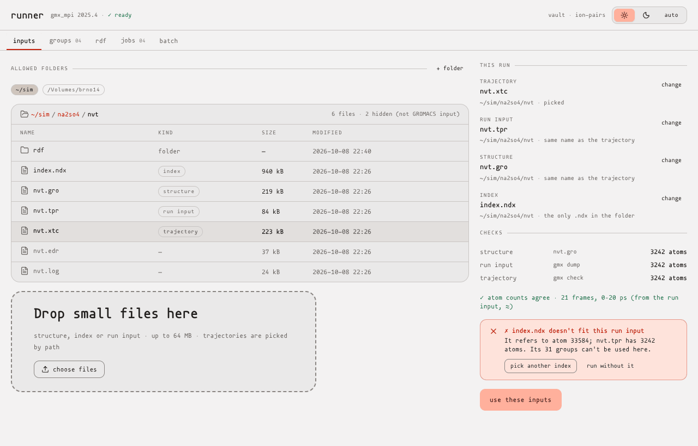 | 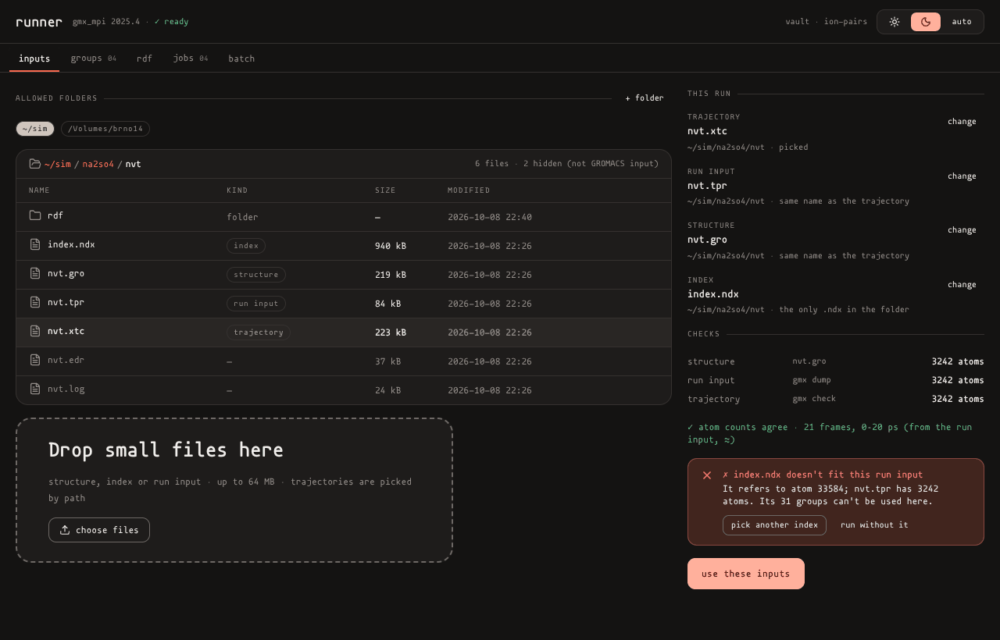 |
| Groups: 3D with groups in their hues, hover label, keys, groups by rule and click, overlap warning | 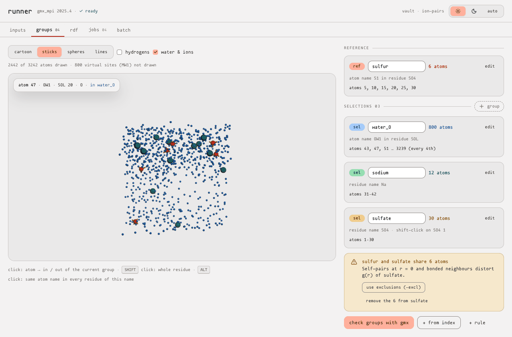 | 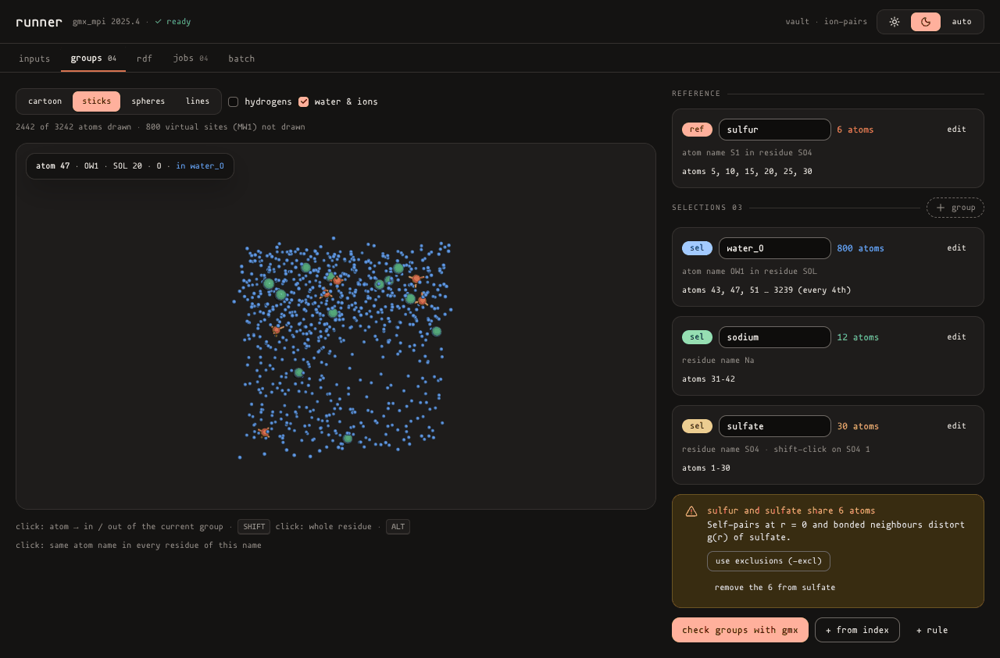 |
| RDF: every option with its flag, default and one-line effect; the command; groups confirmed by `gmx`; what will be written | 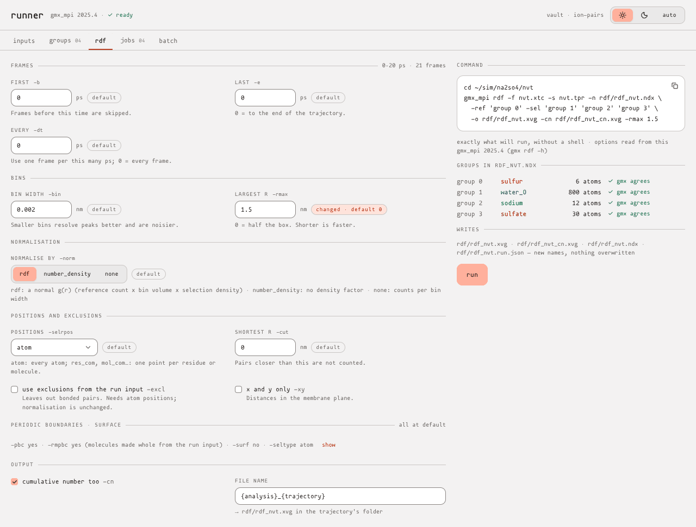 | 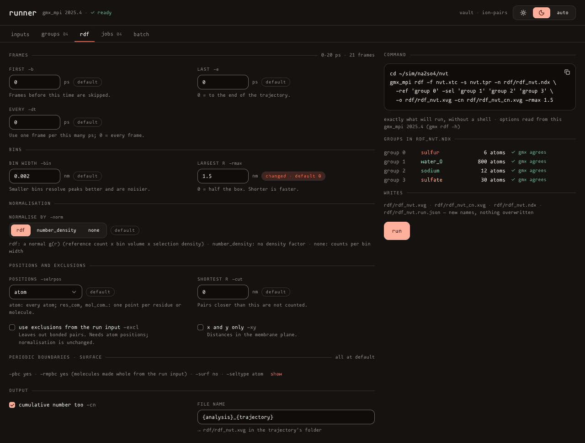 |
| A running job: progress (≈), command, live log, cancel | 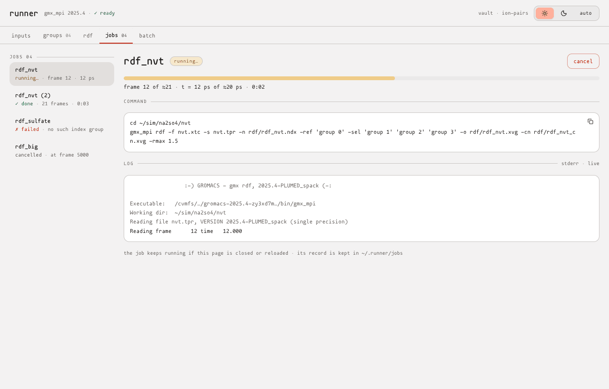 | 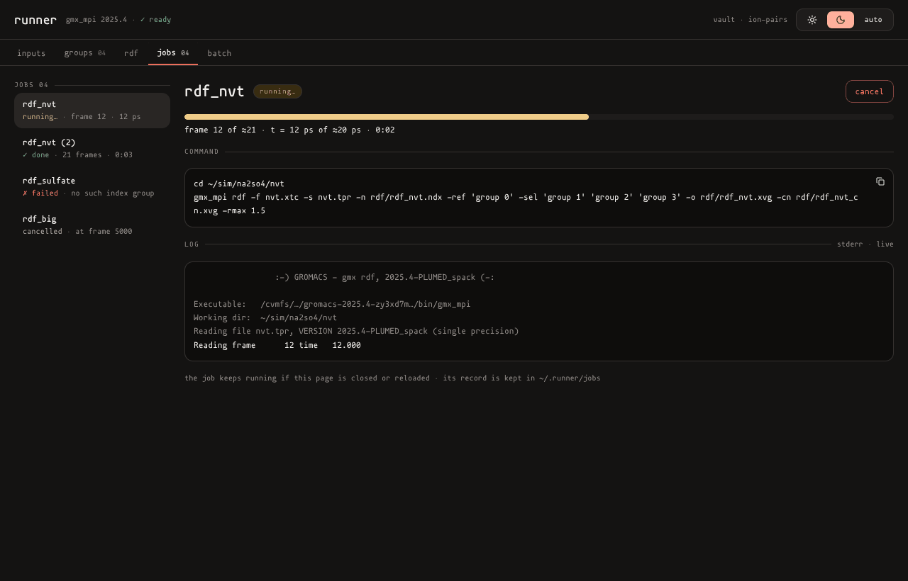 |
| The result: g(r) per selection, first peaks, frames, options under the chart, cumulative number | 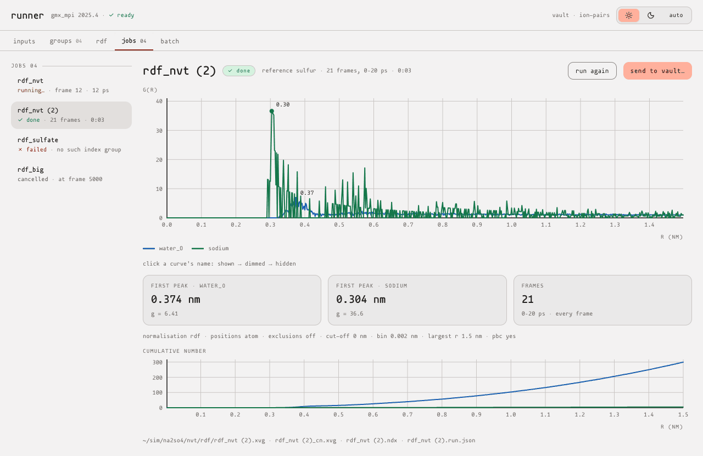 | 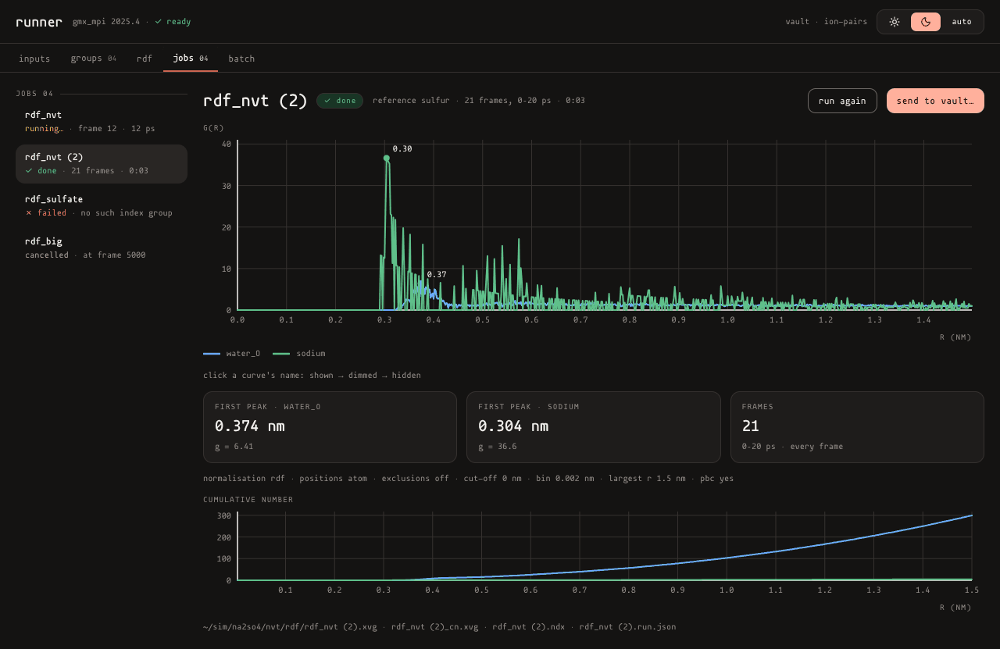 |
| Send to vault: fields with their source, the name from the project's pattern, the landing preview, the one-curve warning | 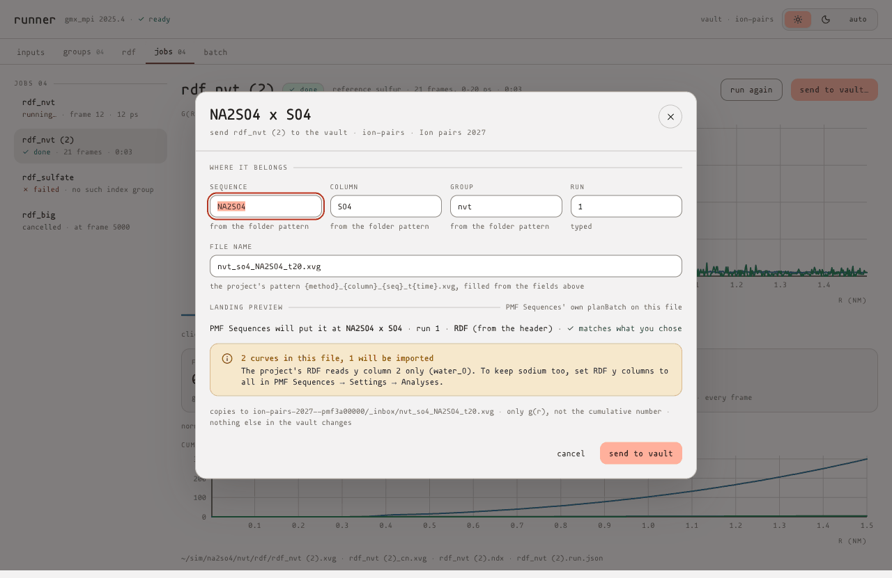 | 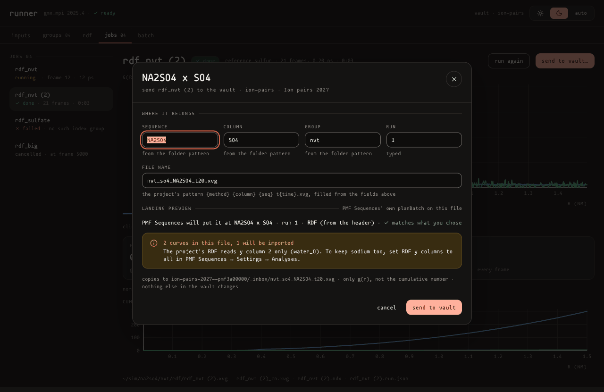 |

**Notes.**
- The 3D view shows water and ions turned on, to pick them.
- The wireframes use the working name `runner` (Q1).
- In the RDF wireframe, `-pbc`, `-rmpbc`, `-surf` and `-seltype` are collapsed into one line while at their defaults, and open with **show**.

## 10. Order

Section 5's order, with two changes:

1. **R5 before R4b.** No `gmx` run writes anything until free names, the output folder and the no-overwrite rule exist. The run record then comes with the first real output. The order becomes R4a → R5 → R4b → R4c.
2. **R4d** (new): the Playwright smoke test, after R4c, if Q17 is yes, because it needs inputs, a run and the chart.

(Q22)

## 11. Summary of what is new beyond the spec

- The repository is empty; the baseline waits for your push.
- A resolve hook is needed for Node to load PMF Sequences.
- Morpheus has no code or log colours.
- 3Dmol's `keepH: false` drops hydrogens.
- GROMACS backs up existing outputs instead of refusing them.
- GROMACS reads group names by their first word and matches by prefix.
- The header has a second line that changes per run.
- The cumulative-number file reads as an RDF.
- PMF Sequences doesn't rescan on focus.
- A folder pattern accepts any path.
- Your `index.ndx` belongs to another system, and your `.tpr` can't be read here.

## 12. Questions

1. **Name.** What is the tool called? The repository is `gmx-cypher`. **Recommendation:** `gmx-cypher` for the GUI, the package and the state folder `~/.gmx-cypher/`; the folder stays `runner/` as the spec says.
2. **Baseline and branch.** `Kikoun18/gmx-cypher` is still empty. These documents are ready and get committed as soon as your repository is there.
   - (a) **Recommended:** you push it, as you chose.
   - (b) I import the zip's `app/` (the tree I tested) as one commit.

   The branch is this session's `claude/quirky-cray-q845sa`, not `runner-rdf`. Is that fine, or shall I push it as `runner-rdf` too?
3. **Server runtime (T1).**
   - (a) **Recommended:** plain Node ≥ 22.18 with the 10-line resolve hook.
   - (b) `vite-node`, the app's own tool, as a dependency.
   - (c) A Vite build of the server.
4. **State folder rules (T5).** Outside it, nothing is ever overwritten or deleted. Inside it, `config.json` and recipes are replaced atomically and job logs are appended.
   - (a) **Recommended:** as described.
   - (b) Everything there versioned or append-only too: more files, same safety.
5. **`module add` (T4).**
   - (a) **Recommended:** start the runner from a shell where `module add gromacs/2025.4-cuda` is done; it inherits the environment.
   - (b) The config also holds environment variables you capture once (`env` after `module add`).
6. **Groups by number, names without spaces (T17, T18).** `-ref 'group 0' -sel 'group 1' …` from the runner's `.ndx`, with names of letters, digits and `_ - + . :`. **Recommendation:** yes. The alternative, quoted names (`group "water_O"`), is open to GROMACS's prefix matching.
7. **Several selections (§10.4, T26).**
   - (a) One run per selection.
   - (b) **Recommended:** one run, one file, one pass; the landing preview warns when the project imports only the first curve, and you set RDF y columns to `all` once per project in PMF Sequences.
   - (c) A per-selection copy, which changes `gmx`'s file.
8. **Criterion C (T28).**
   - (a) **Recommended:** reword it to "identical apart from the creation time and the backronym line".
   - (b) The runner sets `GMX_NO_QUOTES=1`, and a hand-run must set it too.
9. **Output place (T29).**
   - (a) **Recommended:** `<trajectory folder>/rdf/<stem>.*`, with `gmx` working in the trajectory folder.
   - (b) The trajectory folder itself, like your existing `07.md_rdf_*.xvg`.
10. **Trajectory SHA-256 (T31).**
    - (a) **Recommended:** off by default (size and mtime recorded), on by a setting.
    - (b) Always on.
11. **Upload limit (T11).** **Recommendation:** 64 MB. Other value?
12. **Inbox folder name (T35).**
    - (a) **Recommended:** `_inbox`.
    - (b) `_gmx-cypher`.
    - (c) `inbox`.
13. **Older vaults (T32).**
    - (a) **Recommended:** read schemas 1–3 (PMF Sequences upgrades them itself when opened); refuse newer and foreign.
    - (b) Schema 3 only.
14. **Extra arguments (T24).** **Recommendation:** no field; every option is in the form.
15. **Code and log colours (T41).** Morpheus has none.
    - (a) **Recommended:** existing tokens as in T41.
    - (b) You add `code-*`/`log-*` tokens to Morpheus first.
16. **Queue (T39).** **Recommendation:** 2 jobs at a time by default on your machine. Other value?
17. **Playwright smoke test (T46).** **Recommendation:** yes. It costs `@playwright/test` as a devDependency, about 60 lines and about 10 s, and runs as `npm run e2e`, outside `npm test`.
18. **Your `index.ndx`.** It belongs to a 33,584-atom system, not to `nvt.tpr`.
    - (a) **Recommended:** send the matching one (`gmx_mpi make_ndx -f nvt.tpr -o index.ndx`, then `q`) for the manual check, and keep this one as a negative test.
    - (b) It was intended as is.
19. **Real `gmx` here.** My GROMACS is 2023.3 and can't read your 2025 `.tpr`; 2025.4 can't be downloaded here.
    - (a) **Recommended:** send a `.tpr` of the same system made with your 2021.4 `grompp`, which 2023.3 can read, so the `GMX=` tests run here on your system. Real 2025.4 checks stay on your machine.
    - (b) Real-`gmx` tests only on your machine.
20. **More real 2025.4 text, for the parsers' fixtures.** Please send:
    - the stderr of one real run (`gmx_mpi rdf … 2> rdf.stderr`);
    - one failing run's stderr (a wrong group);
    - `gmx_mpi dump -s nvt.tpr | head -250`;
    - `gmx_mpi check -f nvt.xtc 2> check.txt`;
    - the `-os` file of `gmx_mpi select -s nvt.tpr -select 'resname SOL' -os sizes.xvg`;
    - `gmx rdf -h` from 2021.4, if you still use it.

    Otherwise I use the 2023.3 texts captured here: real GROMACS output, another version.
21. **Commit the test system?** **Recommendation:** yes for `nvt.tpr`, `nvt.gro`, `nvt.xtc` (530 kB) and the matching `.ndx`, under `runner/test/fixtures/nvt/`. This container is reset between sessions, so uncommitted files must be re-uploaded. The current `index.ndx` (940 kB) would be committed as the negative fixture only if you agree.
22. **Order (§10).** **Recommendation:** R5 before R4b, and R4d (smoke test) after R4c.
23. **First peak (T27).** **Recommendation:** the highest point of the first stretch where g(r) > 1; if never above 1, the global maximum. Or another rule?
24. **Picking keys (T15).** **Recommendation:** click for an atom, `shift`-click for its residue, `alt`/`option`-click for the same atom name in every residue of this name.
25. **Wireframes (§9, T40).** Approve the layout (tabs, one primary per view, send to vault as a dialog), or say what to change.

## 13. Answers (2026-10-08)

- **Q2:** the zip is the reference; it is committed unchanged as the baseline `e8a452c`; push to `claude/…`.
- **Q11:** no upload limit. Uploads are streamed to disk, so size costs disk, not memory (T11 changed).
- **Q18:** you can't send a matching index now. The tests use one made by real GROMACS (`gmx make_ndx -f nvt.gro`, 2023.3) for your system; your `index.ndx` stays the negative case (not committed, as it isn't part of the test system for this `.tpr`).
- **Q19:** "that's your issue". GROMACS 2025.4 itself is built here from Ubuntu's copy of its source (`gromacs_2025.4.orig.tar.gz`; gromacs.org and GitHub downloads are blocked), CPU-only and without MPI, so real-`gmx` tests can run on your `.tpr` (see `report.md` for what ran).
- **Phase 1–6:** you asked to run all phases without stopping between them.
- **Everything else:** as recommended. The name is **gmx-cypher** (state folder `~/.gmx-cypher/`; the code stays in `runner/`).
